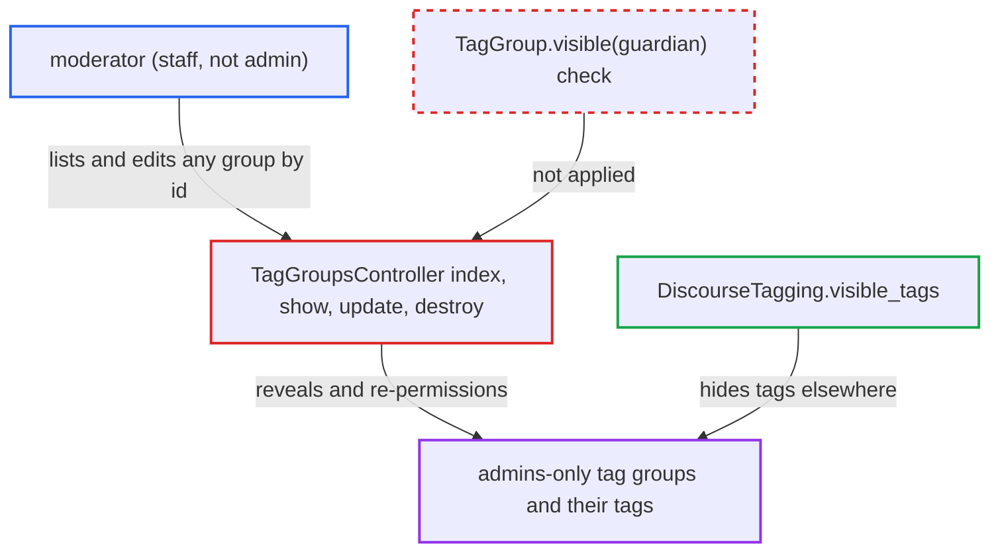

# Moderators can list, edit and re-permission tag groups whose tags are hidden from them

| Field | Value |
|---|---|
| ID | `find_014mW1eCkQPPdqX7pUKCQJYo` |
| Severity | **Low** |
| Status | open |
| CWE | CWE-862 — Missing authorization |
| Created | 2026-10-27T22:10:27.114118Z |
| Claude Security | https://claude.ai/security/findings/find_014mW1eCkQPPdqX7pUKCQJYo |

## Description

A moderator can read, rename, re-permission and delete tag groups that an admin restricted to the `admins` group. This exposes the hidden tag names and the topics carrying them. It needs a moderator account on a site with tagging enabled and an admin-restricted tag group. `TagGroupsController` only checks that the caller is staff and never applies `TagGroup.visible(guardian)`.

1. **Admin** restricts a tag group to the `admins` group. `DiscourseTagging.visible_tags` then hides those tags from every non-admin, moderators included, in topics, tag lists, search and the composer. ([`lib/discourse_tagging.rb:739-754`](https://github.com/cx-benchmark/discourse/blob/e08ed05b4b1ef773b2de7948a8f88a7c182a3520/lib/discourse_tagging.rb#L739-L754))
2. **Moderator** requests `GET /tag_groups.json`. `index` serializes `TagGroup.all` without `TagGroup.visible(guardian)`, and `TagGroupSerializer` lists the names and slugs of every tag in each group. ([`app/controllers/tag_groups_controller.rb:6-26`](https://github.com/cx-benchmark/discourse/blob/e08ed05b4b1ef773b2de7948a8f88a7c182a3520/app/controllers/tag_groups_controller.rb#L6-L26))
3. **Moderator** sends `PUT /tag_groups/<id>.json` with a new `permissions` value for the hidden group. `update` only calls `ensure_can_admin_tag_groups!`, which is `is_staff? && tagging_enabled`, and then loads the group with `TagGroup.find(params[:id])`, ignoring visibility. ([`app/controllers/tag_groups_controller.rb:66-92`](https://github.com/cx-benchmark/discourse/blob/e08ed05b4b1ef773b2de7948a8f88a7c182a3520/app/controllers/tag_groups_controller.rb#L66-L92))
4. **Moderator** sets `permissions` to everyone (`{0: 1}`) or to staff. `tag_groups_params` permits `permissions`, so the admin-only permission set is replaced and the tags become visible to the moderator, and to all users if everyone was chosen. ([`app/controllers/tag_groups_controller.rb:66-92`](https://github.com/cx-benchmark/discourse/blob/e08ed05b4b1ef773b2de7948a8f88a7c182a3520/app/controllers/tag_groups_controller.rb#L66-L92))
5. **Moderator** browses `/tag/<hidden-tag>` and applies or removes the tags on topics. This shows which topics admins flagged with the tags. The moderator may then restore the original permissions; the change reaches the staff action log only after the fact.

## Assessment

The attacker is a moderator, which is staff but not an admin. Tagging must be enabled, and an admin must have restricted a tag group to the `admins` group. The moderator needs only normal access to the tag group endpoints. They read the hidden group with `GET /tag_groups.json` and change it with `PUT /tag_groups/<id>.json`. No victim action is needed. The newer `search` action and `TagSettingsSerializer` do use `TagGroup.visible`, so the older actions look like an oversight rather than a design choice.

Impact: The moderator learns admin-only tag names and which topics carry them. They can also rename, re-permission or delete admin-restricted tag groups, which exposes those tags to all users. Topic content stays governed by category permissions and is not disclosed, and availability is unaffected.

## Recommendation

`TagGroupsController#index/show/update/destroy` authorize on `is_staff?` alone. They ignore `TagGroup.visible` and `DiscourseTagging.visible_tags`, which hide admin-only tag groups from moderators.

Fix criteria: A non-admin staff member can only list, view, edit or delete tag groups that `TagGroup.visible(guardian)` returns for them, or tag-group administration is restricted to admins. `update` does not let a non-admin grant visibility to a group they may not see. A moderator calling `GET /tag_groups.json` does not receive an admins-only tag group. `PUT /tag_groups/<id>` on that group is rejected.

## Evidence

**https://github.com/cx-benchmark/discourse**

- [`app/controllers/tag_groups_controller.rb:6-26`](https://github.com/cx-benchmark/discourse/blob/e08ed05b4b1ef773b2de7948a8f88a7c182a3520/app/controllers/tag_groups_controller.rb#L6-L26)
- [`app/controllers/tag_groups_controller.rb:66-92`](https://github.com/cx-benchmark/discourse/blob/e08ed05b4b1ef773b2de7948a8f88a7c182a3520/app/controllers/tag_groups_controller.rb#L66-L92)
- [`lib/guardian/tag_guardian.rb:39-41`](https://github.com/cx-benchmark/discourse/blob/e08ed05b4b1ef773b2de7948a8f88a7c182a3520/lib/guardian/tag_guardian.rb#L39-L41)
- [`lib/discourse_tagging.rb:739-754`](https://github.com/cx-benchmark/discourse/blob/e08ed05b4b1ef773b2de7948a8f88a7c182a3520/lib/discourse_tagging.rb#L739-L754)
- [`app/models/tag_group.rb:119-144`](https://github.com/cx-benchmark/discourse/blob/e08ed05b4b1ef773b2de7948a8f88a7c182a3520/app/models/tag_group.rb#L119-L144)
- [`app/serializers/tag_group_serializer.rb:6-8`](https://github.com/cx-benchmark/discourse/blob/e08ed05b4b1ef773b2de7948a8f88a7c182a3520/app/serializers/tag_group_serializer.rb#L6-L8)

