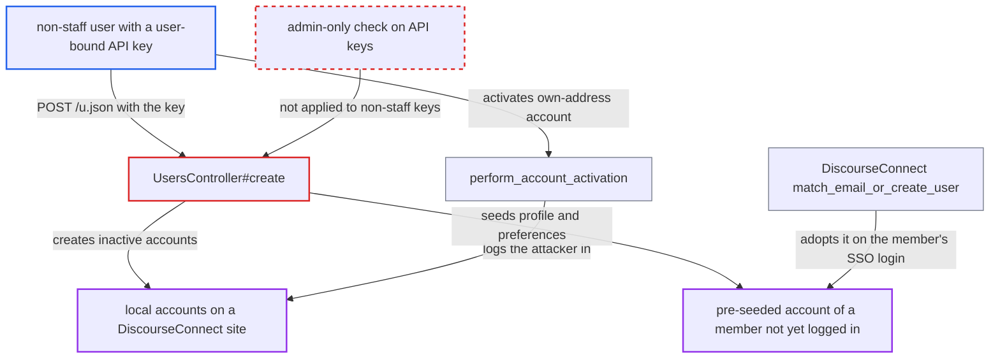

# Non-staff single-user API key bypasses DiscourseConnect-only registration in users#create

| Field | Value |
|---|---|
| ID | `find_01QLuvvggpfQD9Y3ceAP36TS` |
| Severity | **Low** |
| Status | open |
| CWE | CWE-863 — Incorrect authorization |
| Created | 2026-10-27T22:08:01.110452Z |
| Claude Security | https://claude.ai/security/findings/find_01QLuvvggpfQD9Y3ceAP36TS |

## Description

A regular (non-staff) user holding an admin-issued API key can create local accounts on a DiscourseConnect site, where all accounts are meant to come from the identity provider. The key must be a global key bound to that user's own account. The cause is `UsersController#create`, which skips the DiscourseConnect-only registration block for any valid API key (`!is_api?`) instead of only for admin keys.

1. **Admin** issues a global API key bound to a non-staff user. Admins can bind a key to any username, including non-staff accounts, and such a key then acts only as that user. ([`app/controllers/admin/api_controller.rb:83-86`](https://github.com/cx-benchmark/discourse/blob/e08ed05b4b1ef773b2de7948a8f88a7c182a3520/app/controllers/admin/api_controller.rb#L83-L86))
2. **Key holder** sends `POST /u.json` with the `Api-Key` header plus `email`, `username` and `password`. `is_api?` is true for every valid `ApiKey`, including one bound to a non-staff user. ([`lib/auth/default_current_user_provider.rb:170-190`](https://github.com/cx-benchmark/discourse/blob/e08ed05b4b1ef773b2de7948a8f88a7c182a3520/lib/auth/default_current_user_provider.rb#L170-L190))
3. **the action `UsersController#create`** skips the `login.new_registrations_disabled_discourse_connect` refusal. The block applies only when `SiteSetting.enable_discourse_connect && !is_api?` holds, and it never checks that the key's user is an admin. ([`app/controllers/users_controller.rb:734-736`](https://github.com/cx-benchmark/discourse/blob/e08ed05b4b1ef773b2de7948a8f88a7c182a3520/app/controllers/users_controller.rb#L734-L736))
4. **the action `UsersController#create`** creates an inactive account and sends a signup mail. `allow_new_registrations`, `invite_only`, the invite code and the per-IP TL0 limit still apply, and admin-only attributes cannot be set.
5. **Key holder** activates the account with `PUT /u/activate-account/<token>` when the address is their own. The attacker sends the values fetched from `/session/hp.json`, and `perform_account_activation` logs them in with no DiscourseConnect check. ([`app/controllers/users_controller.rb:1189-1197`](https://github.com/cx-benchmark/discourse/blob/e08ed05b4b1ef773b2de7948a8f88a7c182a3520/app/controllers/users_controller.rb#L1189-L1197))
6. **the method `match_email_or_create_user`** adopts the seeded account when the address belongs to a member who has not logged in yet. On that member's later SSO login the account is matched by e-mail if `require_activation` is not sent, and then activated, so the attacker's profile data carries over. ([`app/models/discourse_connect.rb:245-250`](https://github.com/cx-benchmark/discourse/blob/e08ed05b4b1ef773b2de7948a8f88a7c182a3520/app/models/discourse_connect.rb#L245-L250))

## Assessment

The attacker is a non-staff member who holds an admin-issued global API key bound to their own account, on a site with `enable_discourse_connect` on. They send `POST /u.json` with the key and an `email` they control, or the `email` of a member who has not logged in yet. For their own address they activate the account and get a session. For a victim's address they wait, and the victim's later SSO login adopts the seeded account. Registration limits such as `allow_new_registrations`, `invite_only`, the invite code and the per-IP TL0 limit still apply.

Impact: The attacker gets logged-in local accounts on a forum limited to its identity provider, with no SSO record. They can also seed username, name, bio, website, location, muted and allowed-PM users, notification preferences and editable custom fields onto accounts real members later adopt. Username and name are overwritten only when `auth_overrides_username` or `auth_overrides_name` is on, and both default to off. The pre-set password cannot be used because `check_local_login_allowed` blocks password login under DiscourseConnect. No admin-only attribute can be set, no data is disclosed and no existing account is taken over.

## Recommendation

`users#create` lifts the DiscourseConnect-only registration block for any API key (`users_controller.rb:734`). Keys can be bound to non-staff users and should carry only that user's permissions, as the admin-gated local-logins block at `:807-811` already assumes.

Fix criteria: On a DiscourseConnect site, only an API key acting as an admin, or an all-users key with an admin `Api-Username`, can create users. A key bound to a non-staff user gets `login.new_registrations_disabled_discourse_connect`, like a browser request. To verify, use a global key bound to a TL1 user with `enable_discourse_connect` on. `POST /u.json` must create no user, while an admin-bound key still can.

## Evidence

**https://github.com/cx-benchmark/discourse**

- [`app/controllers/users_controller.rb:734-736`](https://github.com/cx-benchmark/discourse/blob/e08ed05b4b1ef773b2de7948a8f88a7c182a3520/app/controllers/users_controller.rb#L734-L736)
- [`app/controllers/users_controller.rb:807-811`](https://github.com/cx-benchmark/discourse/blob/e08ed05b4b1ef773b2de7948a8f88a7c182a3520/app/controllers/users_controller.rb#L807-L811)
- [`spec/requests/users_controller_spec.rb:1012-1016`](https://github.com/cx-benchmark/discourse/blob/e08ed05b4b1ef773b2de7948a8f88a7c182a3520/spec/requests/users_controller_spec.rb#L1012-L1016)
- [`app/controllers/session_controller.rb:865-873`](https://github.com/cx-benchmark/discourse/blob/e08ed05b4b1ef773b2de7948a8f88a7c182a3520/app/controllers/session_controller.rb#L865-L873)
- [`app/controllers/users_controller.rb:1189-1197`](https://github.com/cx-benchmark/discourse/blob/e08ed05b4b1ef773b2de7948a8f88a7c182a3520/app/controllers/users_controller.rb#L1189-L1197)
- [`app/models/discourse_connect.rb:245-250`](https://github.com/cx-benchmark/discourse/blob/e08ed05b4b1ef773b2de7948a8f88a7c182a3520/app/models/discourse_connect.rb#L245-L250)
- [`app/models/discourse_connect.rb:137-142`](https://github.com/cx-benchmark/discourse/blob/e08ed05b4b1ef773b2de7948a8f88a7c182a3520/app/models/discourse_connect.rb#L137-L142)
- [`lib/auth/default_current_user_provider.rb:170-190`](https://github.com/cx-benchmark/discourse/blob/e08ed05b4b1ef773b2de7948a8f88a7c182a3520/lib/auth/default_current_user_provider.rb#L170-L190)
- [`lib/auth/default_current_user_provider.rb:410-419`](https://github.com/cx-benchmark/discourse/blob/e08ed05b4b1ef773b2de7948a8f88a7c182a3520/lib/auth/default_current_user_provider.rb#L410-L419)
- [`app/controllers/admin/api_controller.rb:83-86`](https://github.com/cx-benchmark/discourse/blob/e08ed05b4b1ef773b2de7948a8f88a7c182a3520/app/controllers/admin/api_controller.rb#L83-L86)

