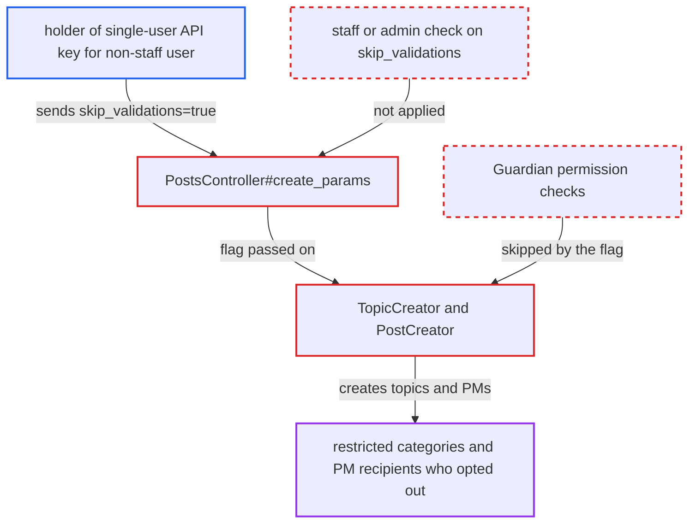

# Non-staff single-user API keys bypass category and PM authorization via skip_validations

| Field | Value |
|---|---|
| ID | `find_01NWT6KbHrnmTsqqaTWtbJyW` |
| Severity | **Low** |
| Status | open |
| CWE | CWE-863 — Incorrect authorization |
| Created | 2026-10-27T21:26:25.410844Z |
| Claude Security | https://claude.ai/security/findings/find_01NWT6KbHrnmTsqqaTWtbJyW |

## Description

A holder of an API key bound to a regular (non-staff) user can create topics in categories that user may not post in. They can also send private messages to people who blocked or opted out of them, and skip tag permissions and post review. The key must have been issued by an admin with User level "Single user", and the request must carry `skip_validations=true`. `PostsController#create_params` trusts that flag for every API key and does not require staff.

1. **API key holder** sends `POST /posts.json` with `skip_validations=true`. The key is bound to a non-staff user. The request targets a category the user cannot post in, or a private message to a user who disallows or ignores them. ([`app/controllers/admin/api_controller.rb:83-86`](https://github.com/cx-benchmark/discourse/blob/e08ed05b4b1ef773b2de7948a8f88a7c182a3520/app/controllers/admin/api_controller.rb#L83-L86))
2. **`DefaultCurrentUserProvider`** marks the request as an API request. Any valid key, including a single-user key for a non-staff account, sets `API_KEY_ENV`, so `is_api?` is true while the request still acts as that user. ([`lib/auth/default_current_user_provider.rb:410-419`](https://github.com/cx-benchmark/discourse/blob/e08ed05b4b1ef773b2de7948a8f88a7c182a3520/lib/auth/default_current_user_provider.rb#L410-L419))
3. **`PostsController#create_params`** permits `skip_validations`, `import_mode`, `created_at`, `external_id` and `embed_url`. The only condition is `is_api?`. There is no staff or admin check, unlike `is_warning` in the same method. ([`app/controllers/posts_controller.rb:943-959`](https://github.com/cx-benchmark/discourse/blob/e08ed05b4b1ef773b2de7948a8f88a7c182a3520/app/controllers/posts_controller.rb#L943-L959))
4. **`NewPostManager`** hands the request to `PostCreator` with `skip_validations` intact. For a user who is not queued for approval, `default_handler` returns nil (`:skip`). Private messages are never queued. ([`lib/new_post_manager.rb:233-263`](https://github.com/cx-benchmark/discourse/blob/e08ed05b4b1ef773b2de7948a8f88a7c182a3520/lib/new_post_manager.rb#L233-L263))
5. **`TopicCreator`** skips the category, private message and tag permission checks. `ensure_can_create!(Topic, category)` and `can_send_private_message?` are not run, and tags are applied through `add_or_create_tags_by_name`. ([`lib/topic_creator.rb:174-177`](https://github.com/cx-benchmark/discourse/blob/e08ed05b4b1ef773b2de7948a8f88a7c182a3520/lib/topic_creator.rb#L174-L177))
6. **`PostCreator#valid?`** skips further validation and creates the post. It also skips the `UserCommScreener` mute and ignore check, recipient limits, spam-host detection and `PostValidator`. ([`lib/post_creator.rb:105-181`](https://github.com/cx-benchmark/discourse/blob/e08ed05b4b1ef773b2de7948a8f88a7c182a3520/lib/post_creator.rb#L105-L181))

## Assessment

The attacker holds an API key that an admin created with User level "Single user" for a non-staff account, such as a personal bot key. The key needs global or `topics:write` scope. The attacker sends `POST /posts.json` with the `Api-Key` header, `title`, `raw`, a `category` they cannot post in, and `skip_validations=true`. Alternatively they send `archetype=private_message` with `target_recipients` naming a user who disallows or ignores them. No victim action is needed.

Impact: The key holder can create topics in staff-only, read-only or private categories. They can send private messages that ignore recipients' opt-outs, mutes and ignores and the sender's own private message permission. They can also apply restricted tags, create unlisted or backdated topics, and use `import_mode` to suppress notifications, spam handling and post review. Content stays attributed to the bound user. Existing content cannot be edited, replies still need topic permission, and nothing private becomes readable.

## Recommendation

(1) `PostsController#create_params` exposes `skip_validations`, `import_mode`, `created_at`, `external_id` and `embed_url` to every API key, although a key can be bound to a non-staff user and should carry only that user's permissions.

Fix criteria: A request authenticated with an API key whose user is not staff or admin cannot set `skip_validations` or `import_mode`, or those values are ignored. With a single-user key for a TL1 user, `POST /posts.json` with `skip_validations=true` is refused exactly as without the flag. This holds for a category the user cannot create topics in and for a private message to a user who disallows private messages. An admin key or an all-users key keeps the import behaviour.

(2) `TopicCreator` and `PostCreator` treat `skip_validations` as a waiver of authorization. It disables `ensure_can_create!(Topic, category)`, `can_send_private_message?`, `can_create_unlisted_topic?` and the tag permission checks, not only the content validators.

Fix criteria: Authorization checks run for any caller-derived request regardless of `skip_validations`: category create permission, private message recipient and sender permission, unlisted-topic permission and tag permissions. Alternatively, the flag can come only from trusted server-side callers. Calling `PostCreator` with `skip_validations: true` from the API path for a non-staff user fails against a restricted category and against a disallowed private message recipient.

## Evidence

**https://github.com/cx-benchmark/discourse**

- [`app/controllers/posts_controller.rb:943-959`](https://github.com/cx-benchmark/discourse/blob/e08ed05b4b1ef773b2de7948a8f88a7c182a3520/app/controllers/posts_controller.rb#L943-L959)
- [`lib/topic_creator.rb:174-177`](https://github.com/cx-benchmark/discourse/blob/e08ed05b4b1ef773b2de7948a8f88a7c182a3520/lib/topic_creator.rb#L174-L177)
- [`lib/topic_creator.rb:365-374`](https://github.com/cx-benchmark/discourse/blob/e08ed05b4b1ef773b2de7948a8f88a7c182a3520/lib/topic_creator.rb#L365-L374)
- [`lib/post_creator.rb:105-181`](https://github.com/cx-benchmark/discourse/blob/e08ed05b4b1ef773b2de7948a8f88a7c182a3520/lib/post_creator.rb#L105-L181)
- [`lib/topic_creator.rb:224-238`](https://github.com/cx-benchmark/discourse/blob/e08ed05b4b1ef773b2de7948a8f88a7c182a3520/lib/topic_creator.rb#L224-L238)
- [`lib/new_post_manager.rb:233-263`](https://github.com/cx-benchmark/discourse/blob/e08ed05b4b1ef773b2de7948a8f88a7c182a3520/lib/new_post_manager.rb#L233-L263)
- [`lib/auth/default_current_user_provider.rb:410-419`](https://github.com/cx-benchmark/discourse/blob/e08ed05b4b1ef773b2de7948a8f88a7c182a3520/lib/auth/default_current_user_provider.rb#L410-L419)
- [`app/controllers/admin/api_controller.rb:83-86`](https://github.com/cx-benchmark/discourse/blob/e08ed05b4b1ef773b2de7948a8f88a7c182a3520/app/controllers/admin/api_controller.rb#L83-L86)

