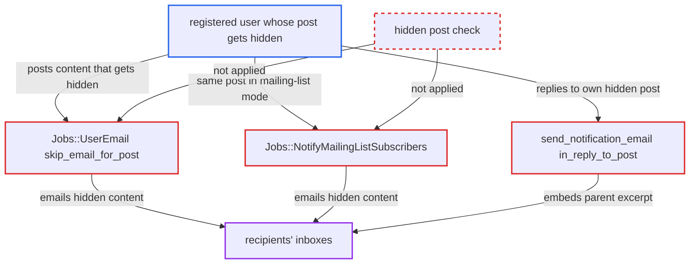

# Notification emails deliver content of posts hidden by moderation flags

| Field | Value |
|---|---|
| ID | `find_012yHwXMsf7dxYPhjRmsVVur` |
| Severity | **Low** |
| Status | open |
| CWE | CWE-862 — Missing authorization |
| Created | 2026-10-27T21:31:05.723366Z |
| Claude Security | https://claude.ai/security/findings/find_012yHwXMsf7dxYPhjRmsVVur |

## Description

A registered user can get spam or abusive posts that the community has hidden with flags emailed to other users anyway. The email goes to watchers, to mailing-list subscribers, and to recipients who enabled `email_in_reply_to`. The email code (`Jobs::UserEmail#skip_email_for_post`, `Jobs::NotifyMailingListSubscribers` and `send_notification_email`) never checks whether a post is hidden.

1. **a registered user** posts content that the community flags and hides. Hiding is done by `Post#hide!`, and the web UI then withholds the content from everyone except staff and the author.
2. **`PostAlerter`** queues the notification email or mailing-list jobs for the post. Notification emails wait `email_time_window_mins` (default 10 minutes) and then run in Sidekiq, so the post can be hidden before the job runs.
3. **the job `Jobs::UserEmail`** sends the email for a post that is now hidden. `skip_email_for_post` skips deleted, user-deleted and topic-less posts but never checks `post.hidden`, and the email renders `post.cooked`. ([`app/jobs/regular/user_email.rb:258-279`](https://github.com/cx-benchmark/discourse/blob/e08ed05b4b1ef773b2de7948a8f88a7c182a3520/app/jobs/regular/user_email.rb#L258-L279))
4. **the job `Jobs::NotifyMailingListSubscribers`** sends the hidden post to mailing-list subscribers. It only checks `trashed?` and `user_deleted?`, not whether the post is hidden. ([`app/jobs/regular/notify_mailing_list_subscribers.rb:38-41`](https://github.com/cx-benchmark/discourse/blob/e08ed05b4b1ef773b2de7948a8f88a7c182a3520/app/jobs/regular/notify_mailing_list_subscribers.rb#L38-L41))
5. **the author of the hidden post** replies to their own hidden post. The author can still see and reply to it, and `PostCreator.set_reply_info` only treats whisper parents specially. ([`lib/post_creator.rb:319-350`](https://github.com/cx-benchmark/discourse/blob/e08ed05b4b1ef773b2de7948a8f88a7c182a3520/lib/post_creator.rb#L319-L350))
6. **the mailer `send_notification_email`** sets `in_reply_to_post` to the hidden parent post. It does this for users with `email_in_reply_to` enabled and applies no visibility filter, unlike `get_context_posts`, which excludes hidden and user-deleted posts. ([`app/mailers/user_notifications.rb:808`](https://github.com/cx-benchmark/discourse/blob/e08ed05b4b1ef773b2de7948a8f88a7c182a3520/app/mailers/user_notifications.rb#L808))
7. **the template `email/notification.html.erb`** renders the hidden parent's excerpt as "In Reply To". The excerpt goes into the email body, so recipients see content the web UI would have replaced with a placeholder. ([`app/views/email/notification.html.erb:23-25`](https://github.com/cx-benchmark/discourse/blob/e08ed05b4b1ef773b2de7948a8f88a7c182a3520/app/views/email/notification.html.erb#L23-L25))

## Assessment

The attacker is a registered user whose post is hidden by flags, or who posts content likely to be flagged. Route one: the post is hidden during the email delay (`email_time_window_mins`, default 10 minutes) or before the Sidekiq job runs, and the email is still sent to every watcher. Route two: the same post goes out through `Jobs::NotifyMailingListSubscribers`. Route three: the author replies to their own hidden post, and the excerpt is emailed as "In Reply To" to every recipient who enabled `email_in_reply_to`, and to themselves or others in mailing-list mode. Recipients receive the content when they open the email.

Impact: Content the community hid, such as spam, phishing links or abuse, is still delivered through the forum's own email, so the moderation control is bypassed. No confidential data is exposed, because the content was public before it was hidden, and availability is not affected.

## Recommendation

The email path treats a hidden post like a visible one. `Jobs::UserEmail#skip_email_for_post`, `Jobs::NotifyMailingListSubscribers` and the `in_reply_to_post` rendering never consult `post.hidden`.

Fix criteria: Notification and mailing-list emails do not include the cooked content of a post that is `hidden` at send time. They either skip the email or use the same placeholder the web shows. `in_reply_to_post` is subject to the same visibility filter as `get_context_posts`. Hiding a post before its `user_email` job runs results in a skipped email. A reply to a hidden post does not embed the parent's excerpt.

## Evidence

**https://github.com/cx-benchmark/discourse**

- [`app/jobs/regular/user_email.rb:258-279`](https://github.com/cx-benchmark/discourse/blob/e08ed05b4b1ef773b2de7948a8f88a7c182a3520/app/jobs/regular/user_email.rb#L258-L279)
- [`app/mailers/user_notifications.rb:808`](https://github.com/cx-benchmark/discourse/blob/e08ed05b4b1ef773b2de7948a8f88a7c182a3520/app/mailers/user_notifications.rb#L808)
- [`app/views/email/notification.html.erb:23-25`](https://github.com/cx-benchmark/discourse/blob/e08ed05b4b1ef773b2de7948a8f88a7c182a3520/app/views/email/notification.html.erb#L23-L25)
- [`app/mailers/user_notifications.rb:617-636`](https://github.com/cx-benchmark/discourse/blob/e08ed05b4b1ef773b2de7948a8f88a7c182a3520/app/mailers/user_notifications.rb#L617-L636)
- [`app/jobs/regular/notify_mailing_list_subscribers.rb:38-41`](https://github.com/cx-benchmark/discourse/blob/e08ed05b4b1ef773b2de7948a8f88a7c182a3520/app/jobs/regular/notify_mailing_list_subscribers.rb#L38-L41)
- [`app/serializers/basic_post_serializer.rb:29-36`](https://github.com/cx-benchmark/discourse/blob/e08ed05b4b1ef773b2de7948a8f88a7c182a3520/app/serializers/basic_post_serializer.rb#L29-L36)
- [`lib/post_creator.rb:319-350`](https://github.com/cx-benchmark/discourse/blob/e08ed05b4b1ef773b2de7948a8f88a7c182a3520/lib/post_creator.rb#L319-L350)

