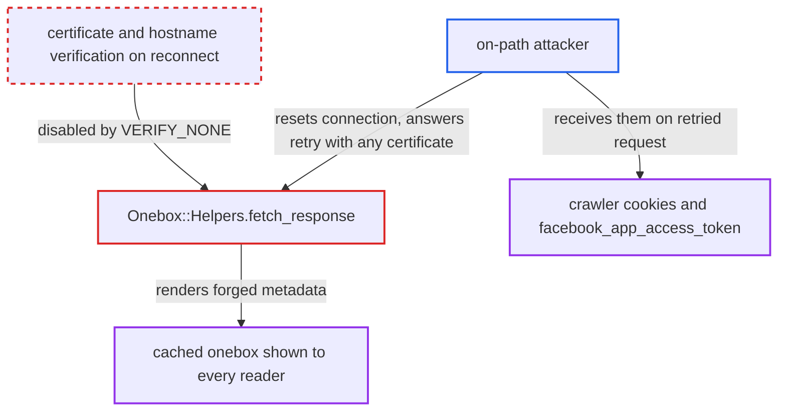

# Onebox content fetches disable TLS certificate verification on (re)connect

| Field | Value |
|---|---|
| ID | `find_01Awcm8mKgEUHmsJ9wbgA8Ai` |
| Severity | **Low** |
| Status | open |
| CWE | CWE-295 — Improper Certificate Validation |
| Created | 2026-10-27T21:22:24.939274Z |
| Claude Security | https://claude.ai/security/findings/find_01Awcm8mKgEUHmsJ9wbgA8Ai |

## Description

An attacker on the network path between the Discourse server and an HTTPS site can serve forged preview content for links to that site, and can capture the crawler cookies sent with the request. The content appears in posts that every reader sees. No account is needed. The cause is `fetch_response`, which turns off certificate verification, so Net::HTTP's automatic retry reconnects unverified.

1. **a user** posts, edits or previews a link to an HTTPS site. The composer preview runs through `OneboxController#show` inside `hijack`, and posts are processed by Sidekiq, so both paths fetch the page. ([`app/controllers/onebox_controller.rb:24-30`](https://github.com/cx-benchmark/discourse/blob/e08ed05b4b1ef773b2de7948a8f88a7c182a3520/app/controllers/onebox_controller.rb#L24-L30))
2. **`FinalDestination#resolve`** resolves the URL with TLS verification. It uses Excon with `ssl_verify_peer_host`, so this step reaches the real origin and yields the crawler cookies. ([`lib/final_destination.rb:279-288`](https://github.com/cx-benchmark/discourse/blob/e08ed05b4b1ef773b2de7948a8f88a7c182a3520/lib/final_destination.rb#L279-L288))
3. **`fetch_response`** opens a verified connection, then sets `verify_mode` to `OpenSSL::SSL::VERIFY_NONE`. `Net::HTTP.start` with `use_ssl: true` verifies the first handshake, but the override is set inside the block, so any later connect on the same object is unverified. ([`lib/onebox/helpers.rb:84-91`](https://github.com/cx-benchmark/discourse/blob/e08ed05b4b1ef773b2de7948a8f88a7c182a3520/lib/onebox/helpers.rb#L84-L91))
4. **on-path attacker** resets or stalls the connection after the GET is written. Net::HTTP treats `ECONNRESET`, `EOFError`, `SSLError` or `ReadTimeout` before the response as a reason to retry an idempotent request.
5. **Net::HTTP** retries the request once on a new connection. `max_retries` is set to 0 only on threads marked by `Middleware::ProcessingRequest`, so Sidekiq jobs and the deferred `hijack` thread keep the default of 1 retry. ([`lib/freedom_patches/net_http.rb:16-21`](https://github.com/cx-benchmark/discourse/blob/e08ed05b4b1ef773b2de7948a8f88a7c182a3520/lib/freedom_patches/net_http.rb#L16-L21))
6. **on-path attacker** answers the retried connection with any certificate and serves crafted HTML or oEmbed data. The reconnect uses `VERIFY_NONE` and skips `post_connection_check`, so neither certificate nor hostname is checked, and the retried request repeats the crawler cookies. ([`lib/onebox/engine/standard_embed.rb:61-67`](https://github.com/cx-benchmark/discourse/blob/e08ed05b4b1ef773b2de7948a8f88a7c182a3520/lib/onebox/engine/standard_embed.rb#L61-L67))
7. **`StandardEmbed`** turns the forged response into onebox content. It also follows an oEmbed URL taken from the forged page, and the attacker controls that response too. The result is sanitized by `Onebox::SanitizeConfig` and cached for a day. ([`lib/onebox/engine/standard_embed.rb:121-133`](https://github.com/cx-benchmark/discourse/blob/e08ed05b4b1ef773b2de7948a8f88a7c182a3520/lib/onebox/engine/standard_embed.rb#L121-L133))

## Assessment

The attacker must be on the network path between the Discourse server and an HTTPS site, for example through compromised hosting, an upstream network or a BGP hijack. The attacker needs no account. Someone only has to post, edit or preview a link to that site. The retry happens in Sidekiq post processing (`CookedPostProcessor` to `Oneboxer.onebox`) and in the composer preview, which any logged-in user can trigger. `fetch_content_length` (used by `PdfOnebox`) sets `VERIFY_NONE` the same way on a HEAD request, so the same retry applies. The `FastImage#setup_http` patch sets `VERIFY_NONE` before connecting, so even its first handshake is unverified. In the shipped code it fetches only the site's own upload URLs, in `Jobs::UpdateAnimatedUploads`. The report assumes the pinned `net-http` 0.10.0 keeps the reconnect and retry behaviour it read in 0.4.1, and that version was not in the checkout.

Impact: The attacker chooses the title, description, images, favicon, links and oEmbed data that Discourse shows under a legitimate site's name. This is content spoofing, limited by `Onebox::SanitizeConfig` (no script execution) and by the iframe origin allowlist. The attacker also receives the requested URL and the crawler cookies. If the non-default `facebook_app_access_token` is set, `InstagramOnebox` puts it in the oEmbed query string, so the attacker receives it too. Availability is not affected.

## Recommendation

`fetch_response`, `fetch_content_length` and the FastImage `setup_http` patch set `VERIFY_NONE` on their Net::HTTP objects. Every connection those objects open, including Net::HTTP's automatic retry and FastImage's first connection, therefore checks neither the certificate nor the hostname of the third-party origin.

Fix criteria: Every server-side HTTPS connection that fetches third-party content verifies the certificate chain and hostname against the system trust store on every connect and reconnect, as `FinalDestination#resolve` does. To check, serve a self-signed or mismatched certificate on a forced retry, and also on the first connection. The fetch must fail. No metadata from that response may be rendered. No cookie or token may be sent to that peer.

## Evidence

**https://github.com/cx-benchmark/discourse**

- [`lib/onebox/helpers.rb:84-91`](https://github.com/cx-benchmark/discourse/blob/e08ed05b4b1ef773b2de7948a8f88a7c182a3520/lib/onebox/helpers.rb#L84-L91)
- [`lib/onebox/helpers.rb:147-165`](https://github.com/cx-benchmark/discourse/blob/e08ed05b4b1ef773b2de7948a8f88a7c182a3520/lib/onebox/helpers.rb#L147-L165)
- [`lib/freedom_patches/net_http.rb:16-21`](https://github.com/cx-benchmark/discourse/blob/e08ed05b4b1ef773b2de7948a8f88a7c182a3520/lib/freedom_patches/net_http.rb#L16-L21)
- [`lib/hijack.rb:33-49`](https://github.com/cx-benchmark/discourse/blob/e08ed05b4b1ef773b2de7948a8f88a7c182a3520/lib/hijack.rb#L33-L49)
- [`app/controllers/onebox_controller.rb:24-30`](https://github.com/cx-benchmark/discourse/blob/e08ed05b4b1ef773b2de7948a8f88a7c182a3520/app/controllers/onebox_controller.rb#L24-L30)
- [`lib/onebox/engine/standard_embed.rb:61-67`](https://github.com/cx-benchmark/discourse/blob/e08ed05b4b1ef773b2de7948a8f88a7c182a3520/lib/onebox/engine/standard_embed.rb#L61-L67)
- [`lib/onebox/engine/standard_embed.rb:121-133`](https://github.com/cx-benchmark/discourse/blob/e08ed05b4b1ef773b2de7948a8f88a7c182a3520/lib/onebox/engine/standard_embed.rb#L121-L133)
- [`lib/onebox/engine/instagram_onebox.rb:63-73`](https://github.com/cx-benchmark/discourse/blob/e08ed05b4b1ef773b2de7948a8f88a7c182a3520/lib/onebox/engine/instagram_onebox.rb#L63-L73)
- [`lib/freedom_patches/fast_image.rb:3-10`](https://github.com/cx-benchmark/discourse/blob/e08ed05b4b1ef773b2de7948a8f88a7c182a3520/lib/freedom_patches/fast_image.rb#L3-L10)
- [`lib/final_destination.rb:279-288`](https://github.com/cx-benchmark/discourse/blob/e08ed05b4b1ef773b2de7948a8f88a7c182a3520/lib/final_destination.rb#L279-L288)

