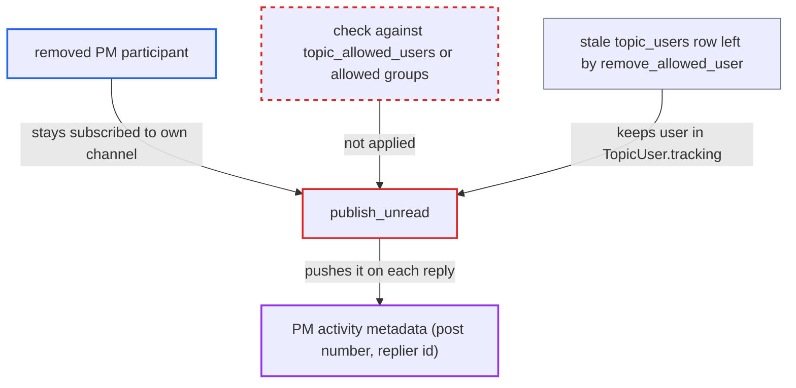

# PM tracking-state unread events still sent to users removed from the private message

| Field | Value |
|---|---|
| ID | `find_01URZVdEg2xR2EYJXDND9WVh` |
| Severity | **Low** |
| Status | open |
| CWE | CWE-862 — Missing Authorization |
| Created | 2026-10-27T21:38:45.889144Z |
| Claude Security | https://claude.ai/security/findings/find_01URZVdEg2xR2EYJXDND9WVh |

## Description

A user who was removed from a private message (PM) keeps receiving live metadata about it. Each new reply sends the topic id, the new post number and the replier's user id. Titles and bodies are not sent. It affects user-only PMs and PMs whose last group was removed. The cause is `publish_unread`, which picks recipients from `TopicUser.tracking` and never checks current PM membership.

1. **PM owner or staff member** removes a participant from the PM. `Topic#remove_allowed_user` deletes only the `topic_allowed_users` row and the user's notifications, and leaves the `topic_users` row. The PM owner (TL2+) or staff can do this. ([`app/models/topic.rb:1316-1341`](https://github.com/cx-benchmark/discourse/blob/e08ed05b4b1ef773b2de7948a8f88a7c182a3520/app/models/topic.rb#L1316-L1341))
2. **`invite_to_private_message`** sets the invitee's tracking level to watching when they are invited. A watching level stays inside `TopicUser.tracking` after the user is removed, so the removed user is still in that scope. ([`app/models/topic.rb:2345-2349`](https://github.com/cx-benchmark/discourse/blob/e08ed05b4b1ef773b2de7948a8f88a7c182a3520/app/models/topic.rb#L2345-L2349))
3. **another participant** posts a new reply in the PM. `Jobs::PostUpdateTopicTrackingState` calls `publish_unread` for every reply after the first post, so this repeats with each reply. ([`app/jobs/regular/post_update_topic_tracking_state.rb:12-14`](https://github.com/cx-benchmark/discourse/blob/e08ed05b4b1ef773b2de7948a8f88a7c182a3520/app/jobs/regular/post_update_topic_tracking_state.rb#L12-L14))
4. **`publish_unread`** selects recipients from `TopicUser.tracking` without checking current membership. It narrows the list by group membership only when the PM still has allowed groups. It never checks `topic_allowed_users`, so a removed user stays on the list. ([`app/models/private_message_topic_tracking_state.rb:117-165`](https://github.com/cx-benchmark/discourse/blob/e08ed05b4b1ef773b2de7948a8f88a7c182a3520/app/models/private_message_topic_tracking_state.rb#L117-L165))
5. **removed user** receives the `unread` message on their own channel. The channel is `/private-message-topic-tracking-state/user/<id>`. The message carries `topic_id`, `highest_post_number`, `created_by_user_id`, `notification_level`, `last_read_post_number` and `group_ids`.

## Assessment

The attacker is a registered user who was a PM participant and was then removed by the PM owner or staff. They need nothing more than to stay subscribed to their own MessageBus channel `/private-message-topic-tracking-state/user/<id>`, as the normal client does, or to poll it directly. It applies to user-only PMs and to PMs whose last group was removed, because no group filter applies then. A PM that still has allowed groups is filtered by the group join, so those users are not affected. Removing an allowed group also leaves its former members' `topic_users` rows.

Impact: The removed user keeps learning that the private conversation goes on. They see how many posts it has, when each reply is posted and which user wrote it (`created_by_user_id`). Titles and bodies are not sent, so the disclosure is metadata only.

## Recommendation

(1) `publish_unread` builds the PM audience from `topic_users` tracking rows instead of from current PM membership in `topic_allowed_users` and `topic_allowed_groups`.

Fix criteria: Only users currently in `topic_allowed_users`, or in a currently allowed group, receive PM tracking-state events. For example, the tracking scope can be intersected with `Topic#all_allowed_users`, or an EXISTS condition can be added. Test: remove user B from a PM, post a reply, and confirm nothing is published on B's `/private-message-topic-tracking-state/user/<B>` channel.

(2) `Topic#remove_allowed_user` and `remove_allowed_group` leave stale `topic_users` rows behind. Removed users therefore stay in every scope built from `TopicUser.tracking`.

Fix criteria: When a user is removed from a PM, their `topic_users` row for that topic is deleted or reset. The same holds for the former members of a removed group. Stale tracking rows can then no longer put them back into tracking or notification audiences.

## Evidence

**https://github.com/cx-benchmark/discourse**

- [`app/models/private_message_topic_tracking_state.rb:117-165`](https://github.com/cx-benchmark/discourse/blob/e08ed05b4b1ef773b2de7948a8f88a7c182a3520/app/models/private_message_topic_tracking_state.rb#L117-L165)
- [`app/models/topic.rb:1316-1341`](https://github.com/cx-benchmark/discourse/blob/e08ed05b4b1ef773b2de7948a8f88a7c182a3520/app/models/topic.rb#L1316-L1341)
- [`app/models/topic.rb:2345-2349`](https://github.com/cx-benchmark/discourse/blob/e08ed05b4b1ef773b2de7948a8f88a7c182a3520/app/models/topic.rb#L2345-L2349)
- [`app/jobs/regular/post_update_topic_tracking_state.rb:12-14`](https://github.com/cx-benchmark/discourse/blob/e08ed05b4b1ef773b2de7948a8f88a7c182a3520/app/jobs/regular/post_update_topic_tracking_state.rb#L12-L14)
- [`lib/guardian/topic_guardian.rb:5-8`](https://github.com/cx-benchmark/discourse/blob/e08ed05b4b1ef773b2de7948a8f88a7c182a3520/lib/guardian/topic_guardian.rb#L5-L8)
- [`app/models/private_message_topic_tracking_state.rb:84-99`](https://github.com/cx-benchmark/discourse/blob/e08ed05b4b1ef773b2de7948a8f88a7c182a3520/app/models/private_message_topic_tracking_state.rb#L84-L99)

