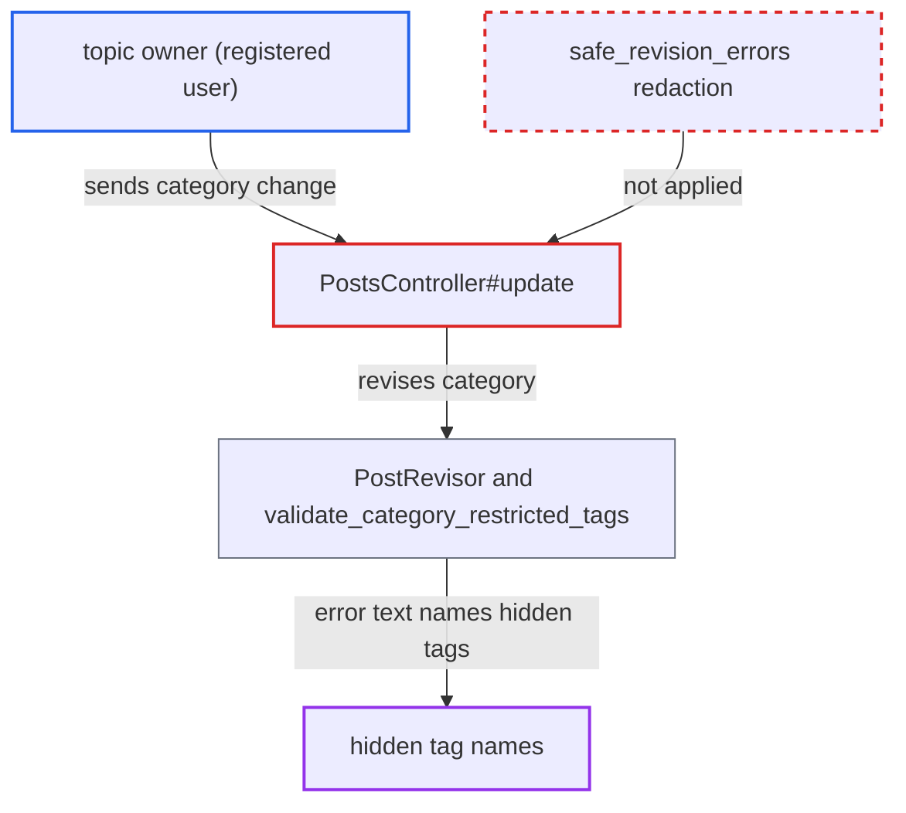

# PUT /posts/:id category-change error discloses hidden tag names on the topic

| Field | Value |
|---|---|
| ID | `find_01UjZSghAX2P1RAufdr83wdk` |
| Severity | **Low** |
| Status | open |
| CWE | CWE-209 — Error message information exposure |
| Created | 2026-10-27T22:37:47.943728Z |
| Claude Security | https://claude.ai/security/findings/find_01UjZSghAX2P1RAufdr83wdk |

## Description

A registered user who owns a topic can learn the names of hidden tags on it, such as staff-only moderation or triage labels. The user asks to move the topic to a category whose tag rules reject the tag, and the 422 error names it. `PostsController#update` returns the category-change errors unfiltered, while the sibling `TopicsController#update` redacts them.

1. **attacker (topic owner)** sends `PUT /posts/<first_post_id>.json` with the unchanged `post[raw]` and a new `post[category_id]`. The category must be one the attacker may post in, and its tag rules must reject the hidden tag; the request is sent within the edit window and carries no `tags` field. ([`app/controllers/posts_controller.rb:234-278`](https://github.com/cx-benchmark/discourse/blob/e08ed05b4b1ef773b2de7948a8f88a7c182a3520/app/controllers/posts_controller.rb#L234-L278))
2. **the `category_id` tracker in `PostRevisor`** validates the move against every tag on the topic. With no `tags` field in the request it uses `tc.topic.tags.map(&:name)`, so hidden tags are included. ([`lib/post_revisor.rb:142-171`](https://github.com/cx-benchmark/discourse/blob/e08ed05b4b1ef773b2de7948a8f88a7c182a3520/lib/post_revisor.rb#L142-L171))
3. **`DiscourseTagging.validate_category_tags`** passes the unfiltered `Tag.where(name:)` set on to the restricted-tag check. Hidden tags are not removed before the error is built. ([`lib/discourse_tagging.rb:294-302`](https://github.com/cx-benchmark/discourse/blob/e08ed05b4b1ef773b2de7948a8f88a7c182a3520/lib/discourse_tagging.rb#L294-L302))
4. **`validate_category_restricted_tags`** adds an error naming the offending tags to `topic.errors`. It builds `tags.forbidden.restricted_tags_cannot_be_used_in_category` or `tags.forbidden.category_does_not_allow_tags` from `unallowed_tags.sort.join` or `unrestricted_tags.sort.join`, and only admins are skipped. ([`lib/discourse_tagging.rb:369-411`](https://github.com/cx-benchmark/discourse/blob/e08ed05b4b1ef773b2de7948a8f88a7c182a3520/lib/discourse_tagging.rb#L369-L411))
5. **the handler `PostsController#update`** returns the errors verbatim with `render_json_error(topic)`. The 422 body names the hidden tags because `PUT /posts/:id` does not use `safe_revision_errors`, which `PUT /t/:id` uses to swap in the generic message. ([`app/controllers/posts_controller.rb:234-278`](https://github.com/cx-benchmark/discourse/blob/e08ed05b4b1ef773b2de7948a8f88a7c182a3520/app/controllers/posts_controller.rb#L234-L278))

## Assessment

The attacker is a registered user (TL0) who owns a topic that staff tagged with a tag from a tag group visible only to groups the attacker is not in. Within the edit window they send `PUT /posts/<first_post_id>.json` with their unchanged `post[raw]` and a `post[category_id]` for a category they may post in whose tag rules reject that tag. That is any category with its own tag restrictions and the default `allow_global_tags=false`, or any category if the hidden tag's group is category-restricted. No victim action is needed.

Impact: The attacker learns the names of staff-only or group-private tags on topics they own, such as moderation or triage labels. The leak is limited to tags on topics the attacker can edit and to the tag names. The move is rolled back and nothing is modified.

## Recommendation

(1) `PostsController#update` returns `PostRevisor` category-change failures as raw `topic.errors.full_messages`. `TopicsController#update` and the MCP tool redact them through `TopicCategoryChangeValidator.safe_revision_errors`, so the posts endpoint is an unguarded exposure point.

Fix criteria: Every HTTP path that can change a topic's category returns no tag name the requester cannot see. Test: a non-staff owner of a topic carrying a staff-only tag sends `PUT /posts/:id` with `post[category_id]` for a category that disallows the tag. The 422 response does not contain the hidden tag's name, for example because it returns the generic `disallowed_tags_generic` message.

(2) `validate_category_restricted_tags` builds its user-facing errors from every offending tag name, whether or not the acting guardian may see the tag. Each caller must therefore remember to redact.

Fix criteria: Error text produced for a non-admin guardian lists only tags in `DiscourseTagging.visible_tags(guardian)`, or is generic when any offending tag is hidden. Test: the same request yields no hidden tag name whichever endpoint drives the category change.

## Evidence

**https://github.com/cx-benchmark/discourse**

- [`app/controllers/posts_controller.rb:234-278`](https://github.com/cx-benchmark/discourse/blob/e08ed05b4b1ef773b2de7948a8f88a7c182a3520/app/controllers/posts_controller.rb#L234-L278)
- [`lib/post_revisor.rb:142-171`](https://github.com/cx-benchmark/discourse/blob/e08ed05b4b1ef773b2de7948a8f88a7c182a3520/lib/post_revisor.rb#L142-L171)
- [`lib/discourse_tagging.rb:369-411`](https://github.com/cx-benchmark/discourse/blob/e08ed05b4b1ef773b2de7948a8f88a7c182a3520/lib/discourse_tagging.rb#L369-L411)
- [`lib/discourse_tagging.rb:294-302`](https://github.com/cx-benchmark/discourse/blob/e08ed05b4b1ef773b2de7948a8f88a7c182a3520/lib/discourse_tagging.rb#L294-L302)
- [`app/services/topic_category_change_validator.rb:47-56`](https://github.com/cx-benchmark/discourse/blob/e08ed05b4b1ef773b2de7948a8f88a7c182a3520/app/services/topic_category_change_validator.rb#L47-L56)
- [`app/controllers/topics_controller.rb:436-510`](https://github.com/cx-benchmark/discourse/blob/e08ed05b4b1ef773b2de7948a8f88a7c182a3520/app/controllers/topics_controller.rb#L436-L510)
- [`spec/requests/topics_controller_spec.rb:3022-3032`](https://github.com/cx-benchmark/discourse/blob/e08ed05b4b1ef773b2de7948a8f88a7c182a3520/spec/requests/topics_controller_spec.rb#L3022-L3032)
- [`app/models/topic.rb:2311-2316`](https://github.com/cx-benchmark/discourse/blob/e08ed05b4b1ef773b2de7948a8f88a7c182a3520/app/models/topic.rb#L2311-L2316)

