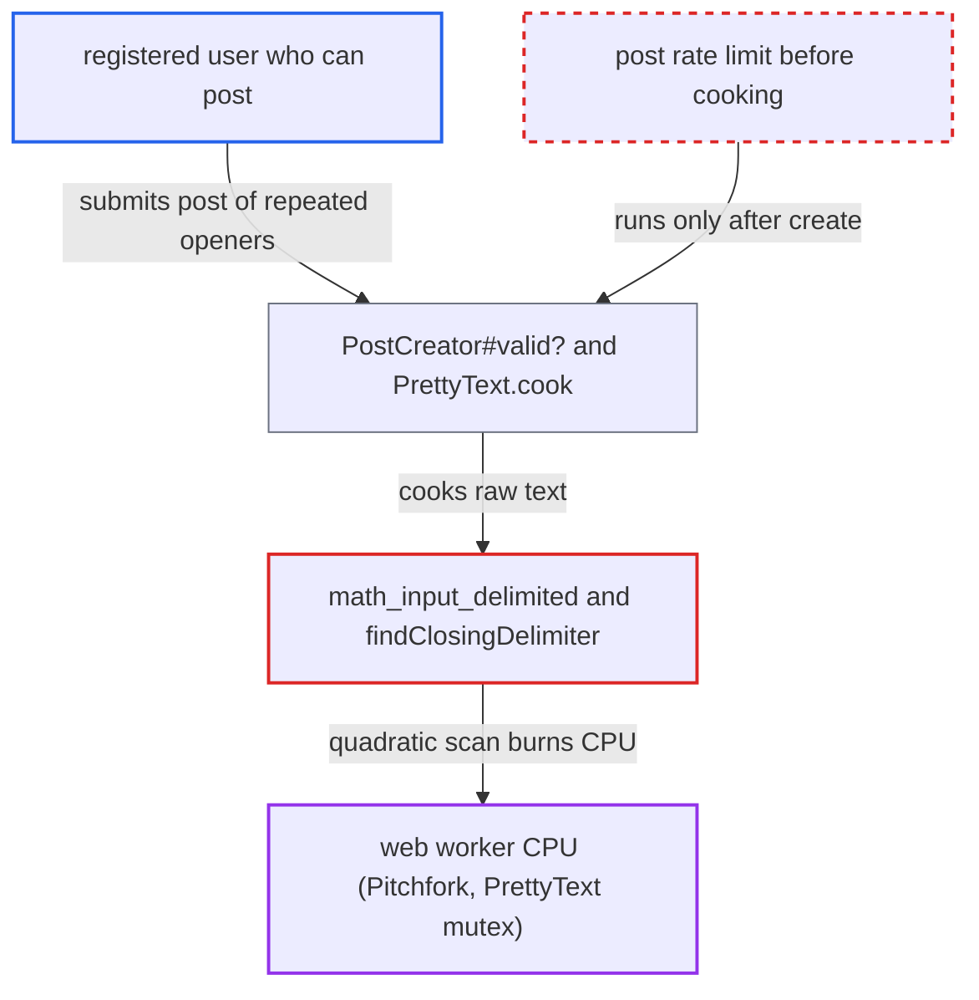

# Quadratic LaTeX paren-delimiter scan in math plugin burns seconds of server cook CPU per post

| Field | Value |
|---|---|
| ID | `find_01E8AxvF6BPQRnXST2ZKVKJf` |
| Severity | **Low** |
| Status | open |
| CWE | CWE-407 — Inefficient Algorithmic Complexity |
| Created | 2026-10-27T21:54:26.930428Z |
| Claude Security | https://claude.ai/security/findings/find_01E8AxvF6BPQRnXST2ZKVKJf |

## Description

Any registered user who can post can tie up web server CPU for seconds per request, so the site slows down for everyone. This needs an admin to have enabled the bundled `discourse-math` plugin (`discourse_math_enabled`, default `false`). The rule `math_input_delimited` rescans the rest of the paragraph for every `\(` opener, so cooking takes quadratic time. The impact is limited degradation, not data loss.

1. **attacker** submits a post made of one paragraph of repeated `\(`. The paragraph runs up to `max_post_length` (default 32,000) and has a few letters added to pass `TextSentinel`. ([`config/site_settings.yml:1348-1351`](https://github.com/cx-benchmark/discourse/blob/e08ed05b4b1ef773b2de7948a8f88a7c182a3520/config/site_settings.yml#L1348-L1351))
2. **`PostCreator#valid?`** runs `PostValidator` in the web request before saving. The link and media validators cook the raw text through `PostAnalyzer#cooked_stripped`, which calls `PrettyText.cook`. ([`lib/post_creator.rb:186-198`](https://github.com/cx-benchmark/discourse/blob/e08ed05b4b1ef773b2de7948a8f88a7c182a3520/lib/post_creator.rb#L186-L198))
3. **`PostAnalyzer#cooked_stripped`** cooks the submitted raw text with `PrettyText.cook`. This cook runs synchronously during validation, before the post is saved. ([`app/models/post_analyzer.rb:144-151`](https://github.com/cx-benchmark/discourse/blob/e08ed05b4b1ef773b2de7948a8f88a7c182a3520/app/models/post_analyzer.rb#L144-L151))
4. **the `math-paren` inline rule** is tried first at every tokenizer position. It is registered before `text`, and the `escape` rule steps over `\(` two characters at a time, so every opener becomes a rule position. ([`plugins/discourse-math/assets/javascripts/lib/discourse-markdown/discourse-math.js:438-440`](https://github.com/cx-benchmark/discourse/blob/e08ed05b4b1ef773b2de7948a8f88a7c182a3520/plugins/discourse-math/assets/javascripts/lib/discourse-markdown/discourse-math.js#L438-L440))
5. **`math_input_delimited`** calls `findClosingDelimiter` for each `\(` opener. With no unescaped closer, or only a multi-line one, it returns `false` without advancing and remembers nothing, so each opener rescans the rest of the paragraph. ([`plugins/discourse-math/assets/javascripts/lib/discourse-markdown/discourse-math.js:183-210`](https://github.com/cx-benchmark/discourse/blob/e08ed05b4b1ef773b2de7948a8f88a7c182a3520/plugins/discourse-math/assets/javascripts/lib/discourse-markdown/discourse-math.js#L183-L210))
6. **`findClosingDelimiter`** walks from the opener to `src.length`, slicing two characters at each step. That is about n²/4 slice-and-compare steps in total, roughly 2.6×10⁸ at 32,000 characters. ([`plugins/discourse-math/assets/javascripts/lib/discourse-markdown/discourse-math.js:160-181`](https://github.com/cx-benchmark/discourse/blob/e08ed05b4b1ef773b2de7948a8f88a7c182a3520/plugins/discourse-math/assets/javascripts/lib/discourse-markdown/discourse-math.js#L160-L181))
7. **post rate limiter** checks the per-user limits only after the cook. The limits run in an `after_create` callback, so a submission that is then rejected has already paid for the full cook. ([`lib/rate_limiter/on_create_record.rb:35-46`](https://github.com/cx-benchmark/discourse/blob/e08ed05b4b1ef773b2de7948a8f88a7c182a3520/lib/rate_limiter/on_create_record.rb#L35-L46))

## Assessment

The attacker is any registered user who may post (TL0), on a site where an admin enabled the math plugin. `discourse_math_enable_latex_delimiters` is on by default once the plugin is enabled. The attacker sends a POST to `/posts` with one paragraph of repeated `\(`. No victim action is needed. Repeated submissions that get rate-limited still pay the cook. An accepted post is cooked again in `before_create_tasks`, on each edit and on rebake in Sidekiq. Chat also enables the feature, but its default 6,000-character limit (12,000 max) keeps that variant small. The analysis assumes markdown-it 15.0.2 keeps the 14.x inline tokenizer behaviour. That version is not in the checkout. The timings are estimates from the iteration count, not measurements.

Impact: Each crafted submission ties up one single-threaded Pitchfork worker (3 by default) for an estimated several seconds at the default length. `PrettyText.protect` holds a per-process mutex while it runs. If the length limit is raised, a cook can run up to the 25 s MiniRacer timeout. Concurrent submissions slow the site for everyone. No data is disclosed or modified, and the timeout and length cap bound each request, so the impact is limited degradation.

## Recommendation

(1) The `\(`...`\)` inline rule rescans the rest of the inline source for every opener and never records that no closer exists. On attacker-chosen input this makes tokenizing O(n²).

Fix criteria: Inline tokenizing of a paragraph takes roughly linear time in its length, however many `\(` openers it contains. One way is to record the position of the next unescaped `\)` per inline state, or that none exists, as markdown-it's backtick rule does. Another is to bound the scan to `posMax`. To verify, cook a 32,000-character paragraph of repeated `\(` with `PrettyText.cook` and in chat. It should finish in about the same time as plain text of that length.

(2) Validation cooks the post in the request before the per-user post rate limits are checked, so submissions that will be rejected still consume a full cook.

Fix criteria: A request that will be rejected for post rate limits does not do a full markdown cook first. To verify, submit a costly post while rate-limited. It is rejected without invoking `PrettyText.cook`.

## Evidence

**https://github.com/cx-benchmark/discourse**

- [`plugins/discourse-math/assets/javascripts/lib/discourse-markdown/discourse-math.js:160-181`](https://github.com/cx-benchmark/discourse/blob/e08ed05b4b1ef773b2de7948a8f88a7c182a3520/plugins/discourse-math/assets/javascripts/lib/discourse-markdown/discourse-math.js#L160-L181)
- [`plugins/discourse-math/assets/javascripts/lib/discourse-markdown/discourse-math.js:183-210`](https://github.com/cx-benchmark/discourse/blob/e08ed05b4b1ef773b2de7948a8f88a7c182a3520/plugins/discourse-math/assets/javascripts/lib/discourse-markdown/discourse-math.js#L183-L210)
- [`plugins/discourse-math/assets/javascripts/lib/discourse-markdown/discourse-math.js:438-440`](https://github.com/cx-benchmark/discourse/blob/e08ed05b4b1ef773b2de7948a8f88a7c182a3520/plugins/discourse-math/assets/javascripts/lib/discourse-markdown/discourse-math.js#L438-L440)
- [`lib/validators/post_validator.rb:14-21`](https://github.com/cx-benchmark/discourse/blob/e08ed05b4b1ef773b2de7948a8f88a7c182a3520/lib/validators/post_validator.rb#L14-L21)
- [`app/models/post_analyzer.rb:144-151`](https://github.com/cx-benchmark/discourse/blob/e08ed05b4b1ef773b2de7948a8f88a7c182a3520/app/models/post_analyzer.rb#L144-L151)
- [`lib/post_creator.rb:186-198`](https://github.com/cx-benchmark/discourse/blob/e08ed05b4b1ef773b2de7948a8f88a7c182a3520/lib/post_creator.rb#L186-L198)
- [`lib/rate_limiter/on_create_record.rb:35-46`](https://github.com/cx-benchmark/discourse/blob/e08ed05b4b1ef773b2de7948a8f88a7c182a3520/lib/rate_limiter/on_create_record.rb#L35-L46)
- [`lib/pretty_text.rb:60`](https://github.com/cx-benchmark/discourse/blob/e08ed05b4b1ef773b2de7948a8f88a7c182a3520/lib/pretty_text.rb#L60)
- [`config/site_settings.yml:1348-1351`](https://github.com/cx-benchmark/discourse/blob/e08ed05b4b1ef773b2de7948a8f88a7c182a3520/config/site_settings.yml#L1348-L1351)
- [`plugins/discourse-math/config/settings.yml:2-14`](https://github.com/cx-benchmark/discourse/blob/e08ed05b4b1ef773b2de7948a8f88a7c182a3520/plugins/discourse-math/config/settings.yml#L2-L14)
- [`plugins/discourse-math/plugin.rb:31-35`](https://github.com/cx-benchmark/discourse/blob/e08ed05b4b1ef773b2de7948a8f88a7c182a3520/plugins/discourse-math/plugin.rb#L31-L35)

