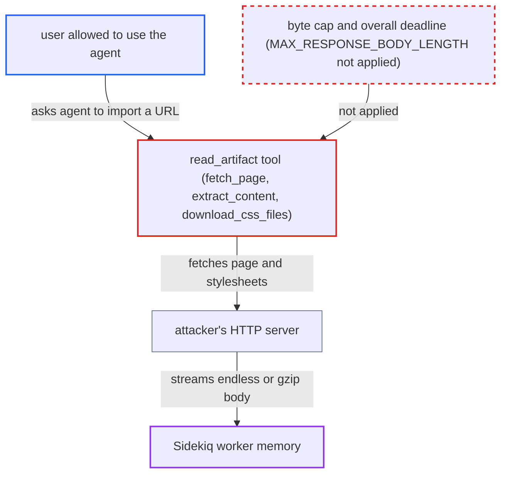

# read_artifact tool buffers unbounded remote HTTP bodies in Sidekiq worker memory

| Field | Value |
|---|---|
| ID | `find_01BqahLMPsgrNuTm9yvT2Hwp` |
| Severity | **Low** |
| Status | open |
| CWE | CWE-770 — Uncontrolled resource consumption |
| Created | 2026-10-27T21:17:25.558078Z |
| Claude Security | https://claude.ai/security/findings/find_01BqahLMPsgrNuTm9yvT2Hwp |

## Description

A user who can talk to an agent with the `read_artifact` tool can crash the Sidekiq background worker. They point the tool at their own web server, which streams an endless or gzip-compressed body. The worker keeps the whole body in memory until it is killed, and the web front end stays up. The cause is that `read_artifact` reads remote bodies with no size or total-time limit.

1. **attacker** asks the agent to import an artifact from a URL on their own server. The attacker needs access to an agent that carries `read_artifact`, and the server must have a public IP so it passes the SSRF filter. ([`plugins/discourse-ai/db/fixtures/agents/603_ai_agents.rb:33-35`](https://github.com/cx-benchmark/discourse/blob/e08ed05b4b1ef773b2de7948a8f88a7c182a3520/plugins/discourse-ai/db/fixtures/agents/603_ai_agents.rb#L33-L35))
2. **the `Jobs::CreateAiReply` Sidekiq job** runs `read_artifact` with the attacker's URL. The LLM chooses to call the tool, and the URL is a tool parameter that came from the conversation.
3. **`fetch_page`** sends the request through `Tool.send_http_request`. This uses `Net::HTTP` via `FinalDestination::HTTP`, which only filters destination IPs, and the default `Accept-Encoding: gzip` lets a small compressed body inflate in memory. ([`plugins/discourse-ai/lib/agents/tools/tool.rb:258-314`](https://github.com/cx-benchmark/discourse/blob/e08ed05b4b1ef773b2de7948a8f88a7c182a3520/plugins/discourse-ai/lib/agents/tools/tool.rb#L258-L314))
4. **attacker's server** returns an endless stream or a gzip bomb. `Net::HTTPResponse#reading_body` drains the whole body even for a non-200 status, and `read_timeout` applies to each socket read, not to the whole transfer, so a continuous stream never times out. ([`plugins/discourse-ai/lib/agents/tools/tool.rb:258-314`](https://github.com/cx-benchmark/discourse/blob/e08ed05b4b1ef773b2de7948a8f88a7c182a3520/plugins/discourse-ai/lib/agents/tools/tool.rb#L258-L314))
5. **`extract_content`** passes the full `response.body` to `Nokogiri.HTML`. The `MAX_HTML_SIZE` (30 KB) truncation happens only after the whole body has been buffered and parsed. ([`plugins/discourse-ai/lib/agents/tools/read_artifact.rb:126-158`](https://github.com/cx-benchmark/discourse/blob/e08ed05b4b1ef773b2de7948a8f88a7c182a3520/plugins/discourse-ai/lib/agents/tools/read_artifact.rb#L126-L158))
6. **`download_css_files`** fetches up to `MAX_CSS_FILES` (5) stylesheet URLs taken from the attacker's page. Each stylesheet body is also read in full, so the attacker can point all five links at the same endless endpoint. ([`plugins/discourse-ai/lib/agents/tools/read_artifact.rb:201-207`](https://github.com/cx-benchmark/discourse/blob/e08ed05b4b1ef773b2de7948a8f88a7c182a3520/plugins/discourse-ai/lib/agents/tools/read_artifact.rb#L201-L207))
7. **Sidekiq process** runs out of memory and is killed or restarted. The kernel OOM-kills it, or the 30-minute RSS check restarts it, and in-flight jobs such as email, webhooks and other AI replies are lost.

## Assessment

The attacker is a user allowed to talk to an agent that carries `read_artifact`. By default that is the staff group, through the seeded Web Creator agent. An admin can also give the tool, or a custom agent with it, to any group. The attacker runs an HTTP server on a public address, and the AI bot must be enabled with an LLM. Another way in: admin-written custom tools that fetch URLs supplied through the LLM use the `http.get/post/...` bindings in `tool_runner/http.rb`. Those bindings also return `response.body` unbounded, and the `ToolRunner` watchdog stops counting time while an attached Ruby function runs.

Impact: One tool call grows the Sidekiq process's memory without bound until it is killed. In-flight background jobs are lost and the job queue stalls, and repeating the request keeps it down. The web front end stays up, and nothing is disclosed or modified.

## Recommendation

(1) `read_artifact` reads the remote page, the remote artifact and each stylesheet body in full, including transparently inflated gzip content, before applying its 30 KB slicing. It ignores the 30 MB cap that the tool framework documents.

Fix criteria: Every remote body `read_artifact` reads is bounded by a byte cap on the decoded data, with an overall transfer deadline, and the transfer is aborted past the cap rather than drained. Pointing the tool at a server that streams an endless or gzip-bomb body, as the page or as each of five stylesheets, leaves worker memory bounded and returns an error.

(2) `Tool.send_http_request` and the shared `read_response_body` helper rely on `Net::HTTP`, which drains any unread body after the request block returns (`Net::HTTPResponse#reading_body`). Breaking out of `read_body` early therefore does not stop the download.

Fix criteria: The shared HTTP helper reads no more than the cap from the socket once a limit is hit, for example by closing the connection, so every tool using it gets a real bound. With an endless-stream server, the bytes received stop near the cap.

(3) The custom-tool `http.*` bindings in `tool_runner/http.rb` return `response.body` unbounded, and the script watchdog does not count time spent in attached functions.

Fix criteria: `_http_get` and the `_http_<method>` bindings read bodies through a bounded reader with an overall deadline. A custom tool calling `http.get` against an endless stream fails with bounded memory and time.

## Evidence

**https://github.com/cx-benchmark/discourse**

- [`plugins/discourse-ai/lib/agents/tools/read_artifact.rb:201-207`](https://github.com/cx-benchmark/discourse/blob/e08ed05b4b1ef773b2de7948a8f88a7c182a3520/plugins/discourse-ai/lib/agents/tools/read_artifact.rb#L201-L207)
- [`plugins/discourse-ai/lib/agents/tools/read_artifact.rb:126-158`](https://github.com/cx-benchmark/discourse/blob/e08ed05b4b1ef773b2de7948a8f88a7c182a3520/plugins/discourse-ai/lib/agents/tools/read_artifact.rb#L126-L158)
- [`plugins/discourse-ai/lib/agents/tools/read_artifact.rb:80-86`](https://github.com/cx-benchmark/discourse/blob/e08ed05b4b1ef773b2de7948a8f88a7c182a3520/plugins/discourse-ai/lib/agents/tools/read_artifact.rb#L80-L86)
- [`plugins/discourse-ai/lib/agents/tools/tool.rb:258-314`](https://github.com/cx-benchmark/discourse/blob/e08ed05b4b1ef773b2de7948a8f88a7c182a3520/plugins/discourse-ai/lib/agents/tools/tool.rb#L258-L314)
- [`plugins/discourse-ai/lib/agents/tools/tool.rb:7-11`](https://github.com/cx-benchmark/discourse/blob/e08ed05b4b1ef773b2de7948a8f88a7c182a3520/plugins/discourse-ai/lib/agents/tools/tool.rb#L7-L11)
- [`plugins/discourse-ai/db/fixtures/agents/603_ai_agents.rb:33-35`](https://github.com/cx-benchmark/discourse/blob/e08ed05b4b1ef773b2de7948a8f88a7c182a3520/plugins/discourse-ai/db/fixtures/agents/603_ai_agents.rb#L33-L35)
- [`plugins/discourse-ai/lib/agents/agent.rb:155-159`](https://github.com/cx-benchmark/discourse/blob/e08ed05b4b1ef773b2de7948a8f88a7c182a3520/plugins/discourse-ai/lib/agents/agent.rb#L155-L159)
- [`plugins/discourse-ai/lib/agents/tool_runner/http.rb:18-33`](https://github.com/cx-benchmark/discourse/blob/e08ed05b4b1ef773b2de7948a8f88a7c182a3520/plugins/discourse-ai/lib/agents/tool_runner/http.rb#L18-L33)

