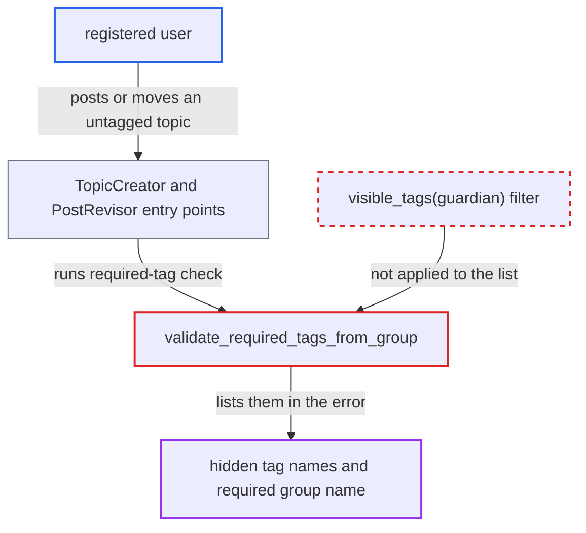

# Required-tag-group error lists tag names hidden from the poster

| Field | Value |
|---|---|
| ID | `find_019jusTwMuFofuhy7kPU3zbh` |
| Severity | **Low** |
| Status | open |
| CWE | CWE-209 — Error message information exposure |
| Created | 2026-10-27T22:38:32.555926Z |
| Claude Security | https://claude.ai/security/findings/find_019jusTwMuFofuhy7kPU3zbh |

## Description

A registered user can learn the names of tags that an admin hid from them, plus the name of the required tag group. The attack needs a category whose required tag group contains hidden tags, and the user must be allowed to post there. `validate_required_tags_from_group` puts the group's full tag list in its error message without applying the tag visibility filter.

1. **the attacker (a registered user)** posts a topic with no tags to the category, or moves an untagged topic into it. The request is `POST /posts` for a new topic, or `PUT /t/:id` for a category move, so the topic has none of the required group's tags. ([`lib/topic_creator.rb:27-46`](https://github.com/cx-benchmark/discourse/blob/e08ed05b4b1ef773b2de7948a8f88a7c182a3520/lib/topic_creator.rb#L27-L46))
2. **the topic validation code** calls `validate_required_tags_from_group` through `validate_category_tags`. It passes the poster's existing tags, which are empty when no tags are sent. ([`lib/discourse_tagging.rb:294-304`](https://github.com/cx-benchmark/discourse/blob/e08ed05b4b1ef773b2de7948a8f88a7c182a3520/lib/discourse_tagging.rb#L294-L304))
3. **the category move code in `PostRevisor`** runs the same `validate_category_tags` check for the new category. This is the second way in, so moving an untagged topic produces the same error as creating one. ([`lib/post_revisor.rb:150-171`](https://github.com/cx-benchmark/discourse/blob/e08ed05b4b1ef773b2de7948a8f88a7c182a3520/lib/post_revisor.rb#L150-L171))
4. **the function `validate_required_tags_from_group`** adds the `tags.required_tags_from_group` error. It returns early only for admins, and the topic has fewer than `min_count` tags from the group. The `tags:` value is `crtg.tag_group.tags.order(:id).pluck(:name).join(", ")`, the whole group, with no `DiscourseTagging.visible_tags(guardian)` or `hidden_tag_names` filter. ([`lib/discourse_tagging.rb:320-343`](https://github.com/cx-benchmark/discourse/blob/e08ed05b4b1ef773b2de7948a8f88a7c182a3520/lib/discourse_tagging.rb#L320-L343))
5. **the server** returns the error to the attacker. The locale string prints the list as "The tags in this group are: %{tags}.", so the 422 or `errors` body shows tag names the attacker is not meant to see. ([`config/locales/server.en.yml:6310-6312`](https://github.com/cx-benchmark/discourse/blob/e08ed05b4b1ef773b2de7948a8f88a7c182a3520/config/locales/server.en.yml#L6310-L6312))

## Assessment

The attacker is a registered user, and a TL0 user qualifies by default under `tag_topic_allowed_groups`. They must be allowed to create topics in a category whose required tag group holds tags hidden from them. An admin must have set this up, and the admin UI allows two such setups. In the first, the required group is set to "Tags are visible only to the following groups" and excludes the poster. In the second, a tag in a public required group is also restricted to a private category through that category's allowed tags. In the second case the category stays usable through the group's visible tags, yet the hidden tag is still listed. The attacker can trigger the error on topic creation, on tag edits, or on a category move.

Impact: The attacker learns the names of tags hidden from them, which may be staff-only or group-only labels, or tags restricted to private categories. They also learn the required group's name. Topics, tag descriptions and tag assignments are not disclosed, nothing is modified, and availability is not affected.

## Recommendation

`validate_required_tags_from_group` builds a user-facing error from every tag in the required group and ignores which tags the poster may see. This breaks the hidden-tag boundary that `DiscourseTagging.visible_tags` enforces in the composer, serializers and search.

Fix criteria: For a non-admin, the `required_tags_from_group` error lists only tag names in `DiscourseTagging.visible_tags(guardian)`, or uses a generic message when none are visible. Test it with a required group set to "visible only to" a group the poster is not in. Test it again with a member tag restricted to a private category. In both cases a failed `POST /posts` and a failed `PUT /t/:id` category move must return no hidden tag name.

## Evidence

**https://github.com/cx-benchmark/discourse**

- [`lib/discourse_tagging.rb:320-343`](https://github.com/cx-benchmark/discourse/blob/e08ed05b4b1ef773b2de7948a8f88a7c182a3520/lib/discourse_tagging.rb#L320-L343)
- [`config/locales/server.en.yml:6310-6312`](https://github.com/cx-benchmark/discourse/blob/e08ed05b4b1ef773b2de7948a8f88a7c182a3520/config/locales/server.en.yml#L6310-L6312)
- [`lib/topic_creator.rb:27-46`](https://github.com/cx-benchmark/discourse/blob/e08ed05b4b1ef773b2de7948a8f88a7c182a3520/lib/topic_creator.rb#L27-L46)
- [`lib/discourse_tagging.rb:294-304`](https://github.com/cx-benchmark/discourse/blob/e08ed05b4b1ef773b2de7948a8f88a7c182a3520/lib/discourse_tagging.rb#L294-L304)
- [`lib/post_revisor.rb:150-171`](https://github.com/cx-benchmark/discourse/blob/e08ed05b4b1ef773b2de7948a8f88a7c182a3520/lib/post_revisor.rb#L150-L171)
- [`app/services/topic_category_change_validator.rb:47-56`](https://github.com/cx-benchmark/discourse/blob/e08ed05b4b1ef773b2de7948a8f88a7c182a3520/app/services/topic_category_change_validator.rb#L47-L56)
- [`lib/discourse_tagging.rb:738-799`](https://github.com/cx-benchmark/discourse/blob/e08ed05b4b1ef773b2de7948a8f88a7c182a3520/lib/discourse_tagging.rb#L738-L799)
- [`lib/discourse_tagging.rb:663`](https://github.com/cx-benchmark/discourse/blob/e08ed05b4b1ef773b2de7948a8f88a7c182a3520/lib/discourse_tagging.rb#L663)
- [`app/serializers/site_category_serializer.rb:27-33`](https://github.com/cx-benchmark/discourse/blob/e08ed05b4b1ef773b2de7948a8f88a7c182a3520/app/serializers/site_category_serializer.rb#L27-L33)

