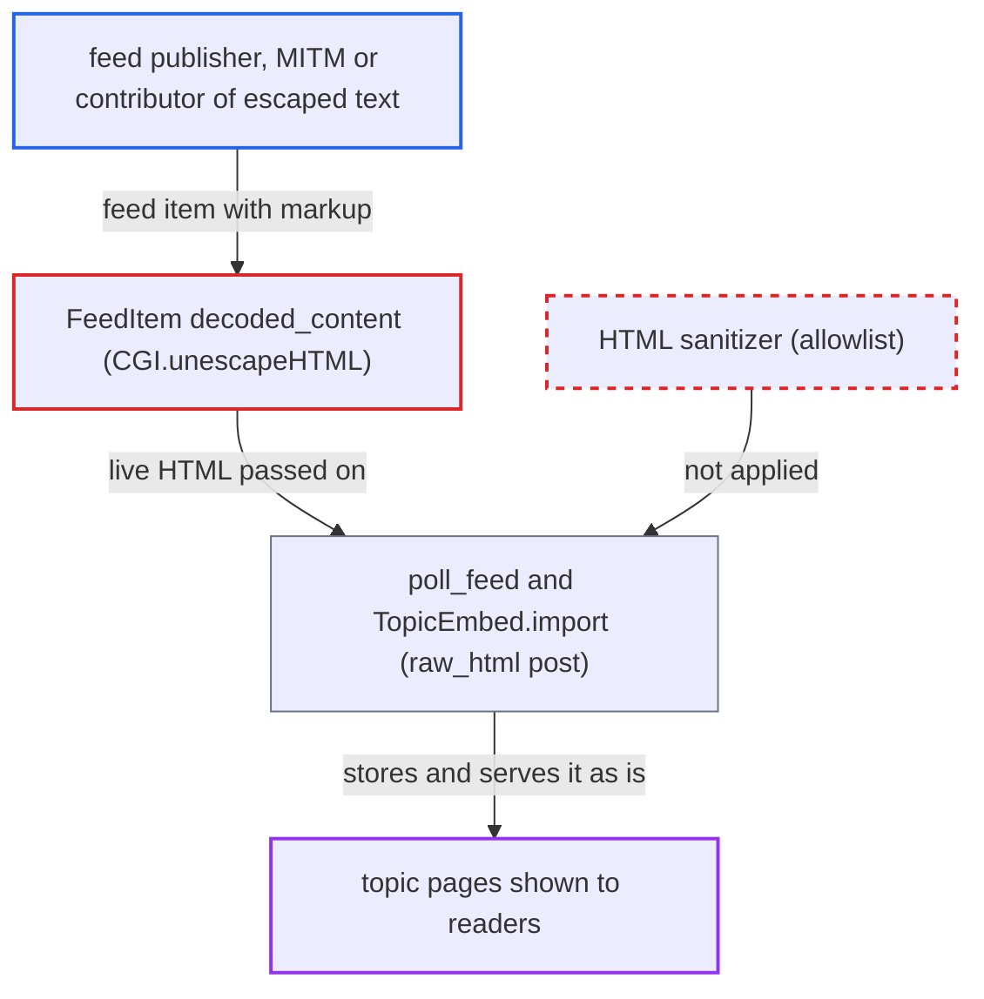

# RSS polling imports feed HTML unsanitized and re-decoded into raw_html posts

| Field | Value |
|---|---|
| ID | `find_01FEpzZiJudbNFt2LENpDXnh` |
| Severity | **Low** |
| Status | open |
| CWE | CWE-79 — Cross-site scripting |
| Created | 2026-10-27T21:38:45.951481Z |
| Claude Security | https://claude.ai/security/findings/find_01FEpzZiJudbNFt2LENpDXnh |

## Description

Anyone who controls or can add text to a polled RSS feed can inject page-wide HTML and CSS into forum topics. Examples are overlays, forms that post to other sites, and redirects. It needs an admin to have enabled the bundled `discourse-rss-polling` plugin with a feed. Script execution is blocked by the default CSP, so the damage is limited, but sites with CSP disabled get full stored XSS. The cause is that `FeedItem#decoded_content` unescapes feed text and `PollFeed#poll_feed` stores it as `raw_html` without sanitizing.

1. **attacker** puts markup into a feed item that the forum polls. The markup is `<style>`, `<iframe>`, `<form>` or `<meta refresh>`, either written directly or entity-escaped, for example inside a code sample, comment or user post on a polled community feed.
2. **the method `FeedItem#decoded_content`** turns escaped text into live markup. It runs `CGI.unescapeHTML` on content the XML parser has already decoded, so text the feed escaped on purpose (such as `&lt;iframe&gt;`) becomes a real tag. ([`plugins/discourse-rss-polling/app/models/discourse_rss_polling/feed_item.rb:25-40`](https://github.com/cx-benchmark/discourse/blob/e08ed05b4b1ef773b2de7948a8f88a7c182a3520/plugins/discourse-rss-polling/app/models/discourse_rss_polling/feed_item.rb#L25-L40))
3. **the method `FeedItem#cook_method`** returns `nil` for HTML content. It does so when the content is typed html/xhtml, or when untyped content has any tag outside `MARKDOWN_COMPATIBLE_TAG_NAMES`, which selects the `raw_html` path. ([`plugins/discourse-rss-polling/app/models/discourse_rss_polling/feed_item.rb:25-40`](https://github.com/cx-benchmark/discourse/blob/e08ed05b4b1ef773b2de7948a8f88a7c182a3520/plugins/discourse-rss-polling/app/models/discourse_rss_polling/feed_item.rb#L25-L40))
4. **the job method `PollFeed#poll_feed`** hands the decoded HTML to `TopicEmbed.import`. It passes `feed_item.decoded_content` and `feed_item.cook_method` with no sanitizing step in between. ([`plugins/discourse-rss-polling/app/jobs/jobs/discourse_rss_polling/poll_feed.rb:108-119`](https://github.com/cx-benchmark/discourse/blob/e08ed05b4b1ef773b2de7948a8f88a7c182a3520/plugins/discourse-rss-polling/app/jobs/jobs/discourse_rss_polling/poll_feed.rb#L108-L119))
5. **the method `TopicEmbed.import`** stores the post with `cook_method: raw_html`. This happens when `embed_support_markdown` is off (the default). `absolutize_urls` only rewrites `a[href]` and `img[src]`, so all other elements and attributes stay. The update branch does the same through `post.revise`. ([`app/models/topic_embed.rb:87-111`](https://github.com/cx-benchmark/discourse/blob/e08ed05b4b1ef773b2de7948a8f88a7c182a3520/app/models/topic_embed.rb#L87-L111))
6. **the method `Post#cook`** returns `raw` unchanged as `cooked`. For `raw_html` posts the feed HTML becomes `cooked` byte for byte, before any filter runs. ([`app/models/post.rb:369-372`](https://github.com/cx-benchmark/discourse/blob/e08ed05b4b1ef773b2de7948a8f88a7c182a3520/app/models/post.rb#L369-L372))
7. **the reader's browser** renders the injected markup on the forum origin. The client inserts `cooked` with `trustHTML`, and the default CSP blocks script but sets no `frame-src`, `style-src`, `form-action` or `img-src`. ([`frontend/discourse/app/components/post/cooked-html.gjs:201`](https://github.com/cx-benchmark/discourse/blob/e08ed05b4b1ef773b2de7948a8f88a7c182a3520/frontend/discourse/app/components/post/cooked-html.gjs#L201))

## Assessment

An admin must have enabled the bundled plugin and configured a feed. The attacker needs no forum account. They can publish the feed, tamper with an `http://` feed in transit (MITM), or contribute escaped text such as code spans, comments or posts to a feed that is polled. On the next poll the item is imported, and any reader who opens the topic receives the markup. Imported topics are unlisted by default (`import_embed_unlisted`) until someone replies, but staff can see them and they are reachable by URL. A later change to a feed item re-injects HTML into a topic that is already visible.

Impact: The attacker gets stored HTML and CSS injection on the forum origin, shown under the configured author's name. This allows defacement, full-page iframe or credential-form overlays that post to an attacker's site, redirects, and CSS `url()` beacons that reveal limited facts about a viewer. The default CSP blocks script, so the loss is limited. Full stored XSS needs CSP to be disabled.

## Recommendation

(1) Remote feed HTML reaches `TopicEmbed.import` unsanitized and is stored as `raw_html`, which `Post#cook` passes through verbatim. This breaks the rule that only allowlisted HTML reaches `post.cooked`.

Fix criteria: On both the create and update paths, every imported feed item's HTML passes a tag, attribute and URL-scheme allowlist at least as strict as the cooked-post sanitizer before it is stored. Polling an item containing `<style>`, `<iframe>`, `<form>`, `<meta>`, `<script>` and `on*` attributes leaves none of them in `post.raw` or `post.cooked`. Links, images and basic formatting survive.

(2) `FeedItem#decoded_content` applies `CGI.unescapeHTML` to content that is already HTML. Text the feed escaped on purpose becomes live markup.

Fix criteria: Escaped text in an HTML feed item stays text after import. A polled item whose body contains `&lt;iframe src=...&gt;` renders as literal text, not as an element.

## Evidence

**https://github.com/cx-benchmark/discourse**

- [`plugins/discourse-rss-polling/app/jobs/jobs/discourse_rss_polling/poll_feed.rb:108-119`](https://github.com/cx-benchmark/discourse/blob/e08ed05b4b1ef773b2de7948a8f88a7c182a3520/plugins/discourse-rss-polling/app/jobs/jobs/discourse_rss_polling/poll_feed.rb#L108-L119)
- [`plugins/discourse-rss-polling/app/models/discourse_rss_polling/feed_item.rb:25-40`](https://github.com/cx-benchmark/discourse/blob/e08ed05b4b1ef773b2de7948a8f88a7c182a3520/plugins/discourse-rss-polling/app/models/discourse_rss_polling/feed_item.rb#L25-L40)
- [`app/models/topic_embed.rb:87-111`](https://github.com/cx-benchmark/discourse/blob/e08ed05b4b1ef773b2de7948a8f88a7c182a3520/app/models/topic_embed.rb#L87-L111)
- [`app/models/topic_embed.rb:358-394`](https://github.com/cx-benchmark/discourse/blob/e08ed05b4b1ef773b2de7948a8f88a7c182a3520/app/models/topic_embed.rb#L358-L394)
- [`app/models/post.rb:369-372`](https://github.com/cx-benchmark/discourse/blob/e08ed05b4b1ef773b2de7948a8f88a7c182a3520/app/models/post.rb#L369-L372)
- [`frontend/discourse/app/components/post/cooked-html.gjs:201`](https://github.com/cx-benchmark/discourse/blob/e08ed05b4b1ef773b2de7948a8f88a7c182a3520/frontend/discourse/app/components/post/cooked-html.gjs#L201)
- [`lib/content_security_policy/default.rb:9-23`](https://github.com/cx-benchmark/discourse/blob/e08ed05b4b1ef773b2de7948a8f88a7c182a3520/lib/content_security_policy/default.rb#L9-L23)

