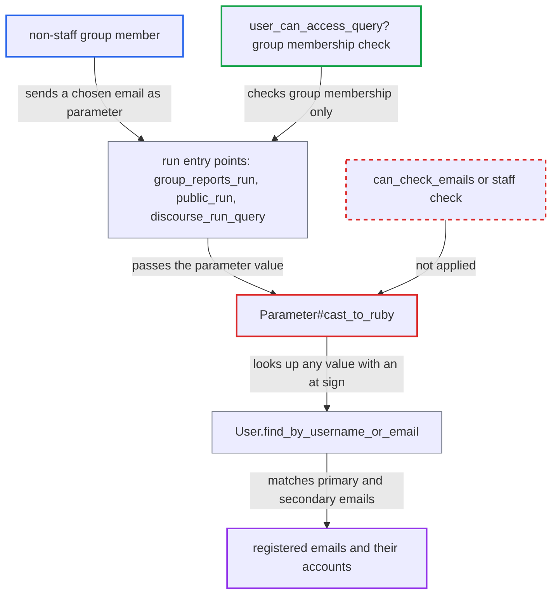

# Shared Data Explorer user params resolve emails for non-staff group members

| Field | Value |
|---|---|
| ID | `find_01HZPBKZqBzz9NX3MnYzRar7` |
| Severity | **Low** |
| Status | open |
| CWE | CWE-359 — Private information exposure |
| Created | 2026-10-27T21:39:45.258860Z |
| Claude Security | https://claude.ai/security/findings/find_01HZPBKZqBzz9NX3MnYzRar7 |

## Description

A non-staff member of a group that an admin shared a Data Explorer query with can check whether any email address is registered. They can also link it, secondary emails included, to a forum account. This needs a shared query that declares a `user_id` or `user_list` parameter. The cause is `Parameter#cast_to_ruby`, which looks up emails with `User.find_by_username_or_email` for every caller. Only targeted guesses are confirmed.

1. **group member** sends a run request with an email address as the user parameter. The routes behind `group_reports_run` and `public_run` skip `ensure_admin`, so any member of the group the query is shared with can call them. ([`plugins/discourse-data-explorer/app/controllers/discourse_data_explorer/query_controller.rb:144-157`](https://github.com/cx-benchmark/discourse/blob/e08ed05b4b1ef773b2de7948a8f88a7c182a3520/plugins/discourse-data-explorer/app/controllers/discourse_data_explorer/query_controller.rb#L144-L157))
2. **guardian checks** allow the request. `user_can_access_query?` and `group_and_user_can_access_query?` test only group membership, not staff status or `can_check_emails?`. ([`plugins/discourse-data-explorer/plugin.rb:131-141`](https://github.com/cx-benchmark/discourse/blob/e08ed05b4b1ef773b2de7948a8f88a7c182a3520/plugins/discourse-data-explorer/plugin.rb#L131-L141))
3. **controller `run`** passes the request's `params[:params]` on to the query runner. The values are the ones the caller chose. ([`plugins/discourse-data-explorer/app/controllers/discourse_data_explorer/query_controller.rb:293-297`](https://github.com/cx-benchmark/discourse/blob/e08ed05b4b1ef773b2de7948a8f88a7c182a3520/plugins/discourse-data-explorer/app/controllers/discourse_data_explorer/query_controller.rb#L293-L297))
4. **`DataExplorer.run_query`** calls `query.cast_params` on those values. A `ValidationError` raised there becomes the `error` that the controller returns to the caller. ([`plugins/discourse-data-explorer/lib/discourse_data_explorer/data_explorer.rb:49-53`](https://github.com/cx-benchmark/discourse/blob/e08ed05b4b1ef773b2de7948a8f88a7c182a3520/plugins/discourse-data-explorer/lib/discourse_data_explorer/data_explorer.rb#L49-L53))
5. **`Parameter#cast_to_ruby`** resolves a non-numeric `user_id` value with `User.find_by_username_or_email`. No staff or email-visibility check runs before this lookup, and an unknown value raises a distinct 'not found' `ValidationError`. ([`plugins/discourse-data-explorer/lib/discourse_data_explorer/parameter.rb:239-242`](https://github.com/cx-benchmark/discourse/blob/e08ed05b4b1ef773b2de7948a8f88a7c182a3520/plugins/discourse-data-explorer/lib/discourse_data_explorer/parameter.rb#L239-L242))
6. **`User.find_by_username_or_email`** treats a value containing `@` as an email and matches it against all users. It uses `find_by_email`, which covers primary and secondary addresses of every user. ([`app/models/user.rb:558-572`](https://github.com/cx-benchmark/discourse/blob/e08ed05b4b1ef773b2de7948a8f88a7c182a3520/app/models/user.rb#L558-L572))
7. **controller `run`** returns a 422 with the 'not found' message, or runs the query for the matched user. The attacker tells the two apart. The output, usually rows or `relations.user`, can show the account behind the email. ([`plugins/discourse-data-explorer/app/controllers/discourse_data_explorer/query_controller.rb:293-297`](https://github.com/cx-benchmark/discourse/blob/e08ed05b4b1ef773b2de7948a8f88a7c182a3520/plugins/discourse-data-explorer/app/controllers/discourse_data_explorer/query_controller.rb#L293-L297))

## Assessment

The attacker is a logged-in non-staff user in a group that an admin shared a query with. The query must declare a `user_id` or `user_list` parameter, and Data Explorer must be enabled. They can use `POST /g/:group_name/reports/:id/run`, `GET /data-explorer/queries/:id/run` or the `discourse_run_query` MCP tool, with parameter values they choose. For a `user_list` parameter each comma-separated entry is looked up, and an unknown entry causes a 500 instead of a 422. The report says no rate limit applies to session (non-API) users. A weaker, related oracle exists for `category_id` parameters, which look up categories by slug or name without a visibility check.

Impact: The attacker can confirm whether chosen email addresses are registered, secondary emails included. They can also tie a registered email to its forum account. Only targeted guesses are confirmed. No email list is dumped and nothing is modified or disrupted.

## Recommendation

`Parameter#cast_to_ruby` resolves `user_id` and `user_list` values with `User.find_by_username_or_email` for every caller. Non-staff group members of shared queries can therefore use the staff-only email-to-account lookup.

Fix criteria: Email-based resolution of user parameters succeeds only when the running user may see emails (for example `can_check_emails` or staff). For other callers, any value containing `@` gives the same generic error whether or not the email exists, through both the controller and the MCP tool. To check, run a shared query as a non-staff member with a registered and an unregistered email. The responses must be identical and contain no result rows.

## Evidence

**https://github.com/cx-benchmark/discourse**

- [`plugins/discourse-data-explorer/lib/discourse_data_explorer/parameter.rb:239-242`](https://github.com/cx-benchmark/discourse/blob/e08ed05b4b1ef773b2de7948a8f88a7c182a3520/plugins/discourse-data-explorer/lib/discourse_data_explorer/parameter.rb#L239-L242)
- [`plugins/discourse-data-explorer/lib/discourse_data_explorer/parameter.rb:277-279`](https://github.com/cx-benchmark/discourse/blob/e08ed05b4b1ef773b2de7948a8f88a7c182a3520/plugins/discourse-data-explorer/lib/discourse_data_explorer/parameter.rb#L277-L279)
- [`app/models/user.rb:558-572`](https://github.com/cx-benchmark/discourse/blob/e08ed05b4b1ef773b2de7948a8f88a7c182a3520/app/models/user.rb#L558-L572)
- [`plugins/discourse-data-explorer/plugin.rb:131-141`](https://github.com/cx-benchmark/discourse/blob/e08ed05b4b1ef773b2de7948a8f88a7c182a3520/plugins/discourse-data-explorer/plugin.rb#L131-L141)
- [`plugins/discourse-data-explorer/app/controllers/discourse_data_explorer/query_controller.rb:144-157`](https://github.com/cx-benchmark/discourse/blob/e08ed05b4b1ef773b2de7948a8f88a7c182a3520/plugins/discourse-data-explorer/app/controllers/discourse_data_explorer/query_controller.rb#L144-L157)
- [`plugins/discourse-data-explorer/app/controllers/discourse_data_explorer/query_controller.rb:293-297`](https://github.com/cx-benchmark/discourse/blob/e08ed05b4b1ef773b2de7948a8f88a7c182a3520/plugins/discourse-data-explorer/app/controllers/discourse_data_explorer/query_controller.rb#L293-L297)
- [`plugins/discourse-data-explorer/lib/discourse_data_explorer/data_explorer.rb:49-53`](https://github.com/cx-benchmark/discourse/blob/e08ed05b4b1ef773b2de7948a8f88a7c182a3520/plugins/discourse-data-explorer/lib/discourse_data_explorer/data_explorer.rb#L49-L53)
- [`plugins/discourse-data-explorer/lib/discourse_data_explorer/mcp_tools.rb:106-126`](https://github.com/cx-benchmark/discourse/blob/e08ed05b4b1ef773b2de7948a8f88a7c182a3520/plugins/discourse-data-explorer/lib/discourse_data_explorer/mcp_tools.rb#L106-L126)

