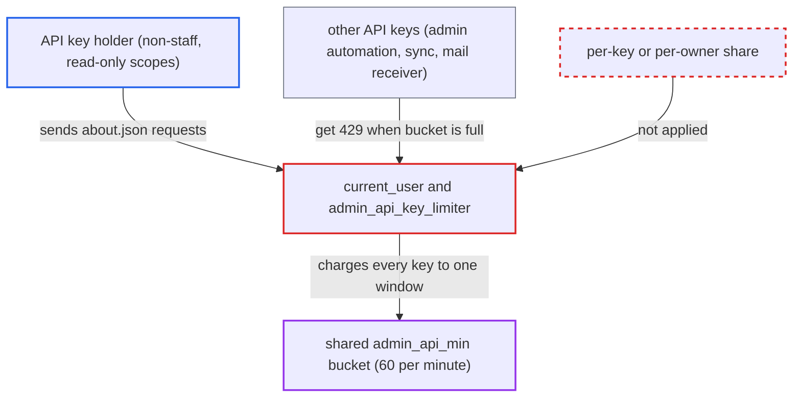

# Site-wide admin API rate-limit bucket lets one scoped API key starve all other keys

| Field | Value |
|---|---|
| ID | `find_01CZ9R7JYkdmvrdyDzK8f62h` |
| Severity | **Low** |
| Status | open |
| CWE | CWE-410 — Insufficient Resource Pool |
| Created | 2026-10-27T22:06:54.044077Z |
| Claude Security | https://claude.ai/security/findings/find_01CZ9R7JYkdmvrdyDzK8f62h |

## Description

A holder of any admin-issued API key, even one bound to a non-staff user with read-only scopes, can use up the request budget that all API keys on the site share. Other keys, such as admin automation, SSO/WordPress sync and the mail receiver, then get HTTP 429 errors. The cause is `admin_api_key_limiter` in `Auth::DefaultCurrentUserProvider#current_user`, which uses one site-wide bucket with no per-key share.

1. **attacker** sends GET `/about.json` requests with their `Api-Key` header at a few requests per second. `ApiKey#request_allowed?` always admits GET `about#index`, so a key with narrow scopes can still send this request. The rate stays under the per-IP limits of 200/min and 50/10s. ([`app/models/api_key.rb:100-109`](https://github.com/cx-benchmark/discourse/blob/e08ed05b4b1ef773b2de7948a8f88a7c182a3520/app/models/api_key.rb#L100-L109))
2. **`current_user` in `Auth::DefaultCurrentUserProvider`** charges each valid API key request to `admin_api_key_limiter` and rolls back the per-IP limiters. The attacker's own per-IP limits therefore never stop the traffic. ([`lib/auth/default_current_user_provider.rb:172-191`](https://github.com/cx-benchmark/discourse/blob/e08ed05b4b1ef773b2de7948a8f88a7c182a3520/lib/auth/default_current_user_provider.rb#L172-L191))
3. **`admin_api_key_limiter`** counts every key against one shared window. The limiter is built with a nil user and type `admin_api_min`, so `build_key` returns the constant `l-rate-limit3::admin_api_min`. The default budget is 60 requests per minute for the whole site. ([`lib/auth/default_current_user_provider.rb:459-472`](https://github.com/cx-benchmark/discourse/blob/e08ed05b4b1ef773b2de7948a8f88a7c182a3520/lib/auth/default_current_user_provider.rb#L459-L472))
4. **`RateLimiter`** gives the bucket no staff exemption and no per-key share. With a nil user there is no staff exemption, so the attacker's requests fill the window like any other. ([`lib/rate_limiter.rb:34-36`](https://github.com/cx-benchmark/discourse/blob/e08ed05b4b1ef773b2de7948a8f88a7c182a3520/lib/rate_limiter.rb#L34-L36))
5. **other API keys** get `RateLimiter::LimitExceeded` (`admin_api_key_rate_limit`, HTTP 429) once the window is full. They fail until a slot frees up, and the attacker keeps sending faster than slots free up, so they take most of them. ([`lib/auth/default_current_user_provider.rb:172-191`](https://github.com/cx-benchmark/discourse/blob/e08ed05b4b1ef773b2de7948a8f88a7c182a3520/lib/auth/default_current_user_provider.rb#L172-L191))

## Assessment

The attacker needs an API key that an admin issued to them, for example one bound to their own non-staff account with read-only scopes. No victim action is needed. The attacker sends GET `/about.json` with the `Api-Key` header at a few requests per second. Any key can do this whatever its scopes. The report notes the shared global design is intentional upstream, and the per-key setting is deprecated, which the owner may weigh when triaging.

Impact: API-key integrations on the site are starved for as long as the attacker keeps up the traffic. Browser sessions and user-API-key clients are not affected, and nothing is disclosed or modified.

## Recommendation

The admin API limiter is keyed on a site-wide constant and every API key charges it equally, so one limited key holder can use up the budget that privileged integrations depend on.

Fix criteria: Traffic from one API key, or from one non-staff key owner, cannot use up the budget that other keys need. Either each key or owner gets its own share, or user-bound non-staff keys stay under the ordinary per-IP/per-user limits and not the shared admin bucket. To verify, saturate one user-bound key with `about.json` requests and confirm that a second key's requests still succeed in the same minute.

## Evidence

**https://github.com/cx-benchmark/discourse**

- [`lib/auth/default_current_user_provider.rb:459-472`](https://github.com/cx-benchmark/discourse/blob/e08ed05b4b1ef773b2de7948a8f88a7c182a3520/lib/auth/default_current_user_provider.rb#L459-L472)
- [`lib/auth/default_current_user_provider.rb:172-191`](https://github.com/cx-benchmark/discourse/blob/e08ed05b4b1ef773b2de7948a8f88a7c182a3520/lib/auth/default_current_user_provider.rb#L172-L191)
- [`lib/rate_limiter.rb:34-36`](https://github.com/cx-benchmark/discourse/blob/e08ed05b4b1ef773b2de7948a8f88a7c182a3520/lib/rate_limiter.rb#L34-L36)
- [`app/models/api_key.rb:100-109`](https://github.com/cx-benchmark/discourse/blob/e08ed05b4b1ef773b2de7948a8f88a7c182a3520/app/models/api_key.rb#L100-L109)
- [`config/discourse_defaults.conf:259`](https://github.com/cx-benchmark/discourse/blob/e08ed05b4b1ef773b2de7948a8f88a7c182a3520/config/discourse_defaults.conf#L259)
- [`app/controllers/admin/api_controller.rb:82-86`](https://github.com/cx-benchmark/discourse/blob/e08ed05b4b1ef773b2de7948a8f88a7c182a3520/app/controllers/admin/api_controller.rb#L82-L86)

