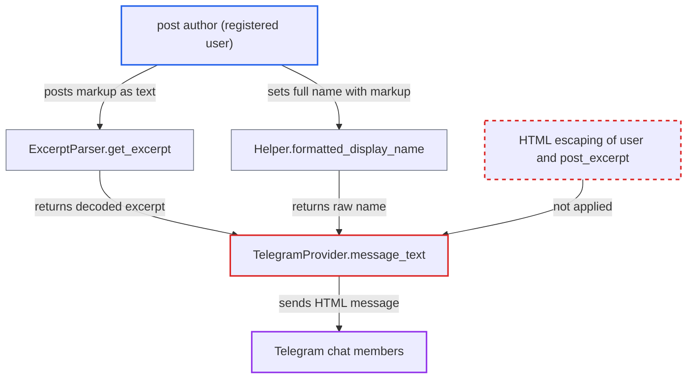

# Telegram HTML-mode notification interpolates unescaped post excerpt and author name

| Field | Value |
|---|---|
| ID | `find_01QiLvVyrkZVD4X28EiNwSfy` |
| Severity | **Low** |
| Status | open |
| CWE | CWE-116 — Improper output encoding |
| Created | 2026-10-27T21:41:07.182096Z |
| Claude Security | https://claude.ai/security/findings/find_01QiLvVyrkZVD4X28EiNwSfy |

## Description

Any registered user who can post where a Telegram rule watches can inject their own formatting and links into the forum bot's Telegram messages. That can make a message look like an official notice with disguised links. The same input can also make Telegram reject the message, so that notification is dropped. This needs the plugin, the Telegram provider and a rule enabled, all off by default. The cause is `TelegramProvider.message_text`, which escapes only `title` and puts `user` and `post_excerpt` into the HTML template raw.

1. **attacker (registered user)** posts text containing markup characters in a watched category or topic. The markup is written as a backslash-escaped character or inside an inline code span, for example a closing pre tag followed by a fake bold header and a link, so it is stored as plain text.
2. **`ExcerptParser.get_excerpt`** turns the escaped text back into raw characters. `characters` HTML-escapes the text, but with `text_entities: true` the method then runs `CGI.unescapeHTML` on the whole excerpt, which returns raw `<`, `>`, `&` and `"`. ([`lib/excerpt_parser.rb:35-47`](https://github.com/cx-benchmark/discourse/blob/e08ed05b4b1ef773b2de7948a8f88a7c182a3520/lib/excerpt_parser.rb#L35-L47))
3. **`TelegramProvider.message_text`** fills the Telegram message template with unescaped values. Only `title` goes through `CGI.escapeHTML`; `user` (the author's full name, which has no character restriction) and `post_excerpt` are interpolated as they are. ([`plugins/discourse-chat-integration/lib/discourse_chat_integration/provider/telegram/telegram_provider.rb:129-147`](https://github.com/cx-benchmark/discourse/blob/e08ed05b4b1ef773b2de7948a8f88a7c182a3520/plugins/discourse-chat-integration/lib/discourse_chat_integration/provider/telegram/telegram_provider.rb#L129-L147))
4. **message template `chat_integration.provider.telegram.message`** places the excerpt inside a pre block and the name inside a bold tag. Attacker text can close the `<pre>` block and add its own tags. ([`plugins/discourse-chat-integration/config/locales/server.en.yml:229-232`](https://github.com/cx-benchmark/discourse/blob/e08ed05b4b1ef773b2de7948a8f88a7c182a3520/plugins/discourse-chat-integration/config/locales/server.en.yml#L229-L232))
5. **`trigger_notification`** sends the message to Telegram with `parse_mode: "html"`. Telegram therefore interprets the injected markup instead of showing it as text. ([`plugins/discourse-chat-integration/lib/discourse_chat_integration/provider/telegram/telegram_provider.rb:149-174`](https://github.com/cx-benchmark/discourse/blob/e08ed05b4b1ef773b2de7948a8f88a7c182a3520/plugins/discourse-chat-integration/lib/discourse_chat_integration/provider/telegram/telegram_provider.rb#L149-L174))
6. **Telegram chat members** receive a bot message with attacker-chosen formatting, or no message at all. Valid injected markup is shown to every chat member; malformed markup is rejected, `trigger_notification` raises `ProviderError`, and `Manager.trigger_notifications` sets an error on the channel and drops the notification. ([`plugins/discourse-chat-integration/app/services/manager.rb:9-121`](https://github.com/cx-benchmark/discourse/blob/e08ed05b4b1ef773b2de7948a8f88a7c182a3520/plugins/discourse-chat-integration/app/services/manager.rb#L9-L121))

## Assessment

The attacker is any registered user who can post in a category, or reply in a topic, that a Telegram chat-integration rule watches. No victim action is needed. The plugin and the Telegram provider must be enabled with a rule, and both are off by default. There are two ways in. The first is the post text, written as a backslash-escaped character or in a code span so that it cooks to escaped entities. The second is the author's full name, which the validator only checks for presence and which goes into the bold tag unescaped. Legitimate posts whose excerpt contains `<`, such as code, hit the same failure by accident.

Impact: The attacker controls the markup of an outgoing bot notification beyond the plain text the provider intends. They can forge a header line and add disguised text links. They can also make Telegram reject the message, which drops that notification and sets an error on the channel. Nothing is disclosed on the Discourse side, and the dropped notification affects only the attacker's own post.

Subsequent-system impact: Telegram chat members, often staff following a moderation feed, see an official-looking forum bot message with attacker-chosen formatting, disguised clickable links and forged header lines. This enables phishing or impersonation. No Telegram data is read or destroyed. The report assumes Telegram's HTML parse mode behaves as described, which is outside this repository.

## Recommendation

The entity-decoded post excerpt and the author's full name are put into a message sent in Telegram's HTML parse mode without HTML escaping, so the author controls the delivered markup and can make delivery fail. Only `title` is escaped.

Fix criteria: Every value interpolated into the Telegram HTML message (`user`, `post_excerpt`, `title` and the URL attribute) is HTML-escaped for Telegram's HTML parse mode, or the message is built without HTML parse mode. A post in a watched category containing `</pre><a href="https://evil.example">x</a>` and `<x>` produces a delivered Telegram message that shows those characters literally inside the `<pre>` block. A user whose full name contains `<b>` produces a delivered message that shows it literally.

## Evidence

**https://github.com/cx-benchmark/discourse**

- [`plugins/discourse-chat-integration/lib/discourse_chat_integration/provider/telegram/telegram_provider.rb:129-147`](https://github.com/cx-benchmark/discourse/blob/e08ed05b4b1ef773b2de7948a8f88a7c182a3520/plugins/discourse-chat-integration/lib/discourse_chat_integration/provider/telegram/telegram_provider.rb#L129-L147)
- [`plugins/discourse-chat-integration/lib/discourse_chat_integration/provider/telegram/telegram_provider.rb:149-174`](https://github.com/cx-benchmark/discourse/blob/e08ed05b4b1ef773b2de7948a8f88a7c182a3520/plugins/discourse-chat-integration/lib/discourse_chat_integration/provider/telegram/telegram_provider.rb#L149-L174)
- [`plugins/discourse-chat-integration/config/locales/server.en.yml:229-232`](https://github.com/cx-benchmark/discourse/blob/e08ed05b4b1ef773b2de7948a8f88a7c182a3520/plugins/discourse-chat-integration/config/locales/server.en.yml#L229-L232)
- [`lib/excerpt_parser.rb:35-47`](https://github.com/cx-benchmark/discourse/blob/e08ed05b4b1ef773b2de7948a8f88a7c182a3520/lib/excerpt_parser.rb#L35-L47)
- [`lib/excerpt_parser.rb:193-221`](https://github.com/cx-benchmark/discourse/blob/e08ed05b4b1ef773b2de7948a8f88a7c182a3520/lib/excerpt_parser.rb#L193-L221)
- [`plugins/discourse-chat-integration/app/helpers/helper.rb:216-232`](https://github.com/cx-benchmark/discourse/blob/e08ed05b4b1ef773b2de7948a8f88a7c182a3520/plugins/discourse-chat-integration/app/helpers/helper.rb#L216-L232)
- [`lib/validators/user_full_name_validator.rb:3-9`](https://github.com/cx-benchmark/discourse/blob/e08ed05b4b1ef773b2de7948a8f88a7c182a3520/lib/validators/user_full_name_validator.rb#L3-L9)
- [`plugins/discourse-chat-integration/app/services/manager.rb:9-121`](https://github.com/cx-benchmark/discourse/blob/e08ed05b4b1ef773b2de7948a8f88a7c182a3520/plugins/discourse-chat-integration/app/services/manager.rb#L9-L121)

