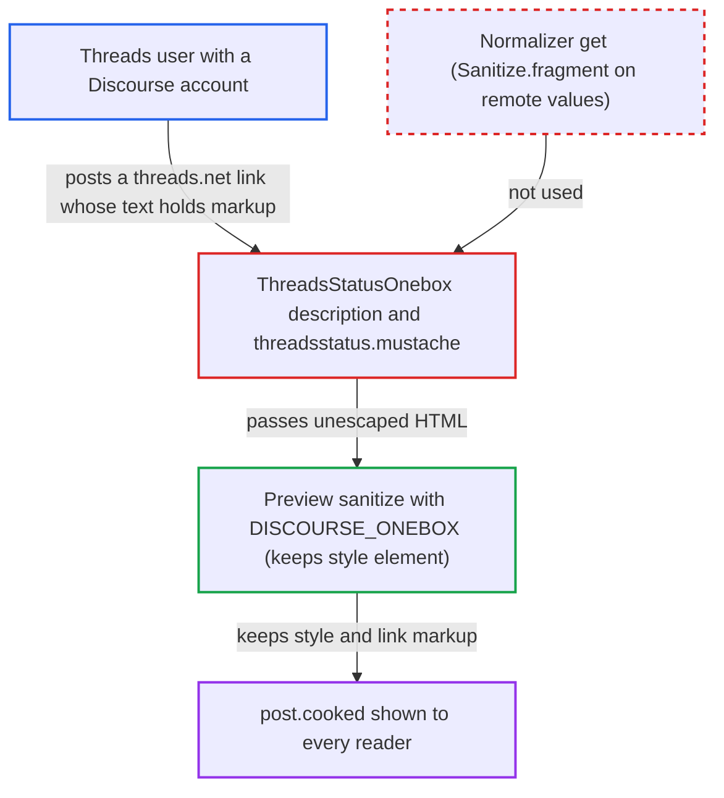

# Threads onebox renders remote post text as raw HTML, allowing stored CSS/HTML injection

| Field | Value |
|---|---|
| ID | `find_01BrhYyxtgr5uE94ZQDDxNfW` |
| Severity | **Low** |
| Status | open |
| CWE | CWE-79 — HTML injection |
| Created | 2026-10-27T21:25:53.935358Z |
| Claude Security | https://claude.ai/security/findings/find_01BrhYyxtgr5uE94ZQDDxNfW |

## Description

A Threads user with a Discourse account that can post a link can inject their own CSS and HTML into a forum post. Every reader of the topic gets it. Scripts do not run, but the attacker can restyle or hide page content and overlay an invisible link. The cause is `ThreadsStatusOnebox#description`, which puts remote post text into the template unescaped.

1. **Attacker** publishes a Threads post containing markup. The text can be a ``, or an `<a>` with a `style` attribute such as `position:fixed;top:0;left:0;width:100%;height:100%;z-index:9999` that points to a phishing page. Then they post its `threads.net/t/…` URL in a topic. This only works while `threads.net` still serves post pages with server-rendered `og:description` in the format the engine expects. If it redirects to `threads.com`, `FinalDestination` follows the redirect and this engine, which matches only `threads.net`, is never chosen. The Twitter/X onebox is not affected. X encodes `og:description` twice, so a typed `<` stays text.

Impact: The attacker can restyle or hide any element on pages that show the post, for example blank the topic, hide controls or show fake notices. They can also lay an invisible full-page link to a page they control over the content. `background-image` URLs they choose leak viewers' IP addresses, and attribute selectors can probe a few attribute values. Scripts cannot run, because `script-src` and the sanitizer block them and `object-src 'none'` blocks `<embed>`, so this is stored HTML/CSS injection only. It is still more than users may do, because the post sanitizer does not let them post `<a href=...>` renders as literal text inside the onebox and creates no new elements.

(2) `Onebox::SanitizeConfig::ONEBOX` inherits Sanitize `RELAXED`, which keeps top-level `<style>` and the `style` attribute on every element. Any engine that lets markup through can therefore restyle the whole page.

Fix criteria: Sanitized onebox output never contains a `<style>` element. `style` attributes are removed or limited to the properties the templates need, such as `float`, `clear` and `--aspect-ratio`. A fragment containing `<style>` or `position:fixed` comes out of the sanitizer without them.

## Evidence

**https://github.com/cx-benchmark/discourse**

- [`lib/onebox/templates/threadsstatus.mustache:6`](https://github.com/cx-benchmark/discourse/blob/e08ed05b4b1ef773b2de7948a8f88a7c182a3520/lib/onebox/templates/threadsstatus.mustache#L6)
- [`lib/onebox/engine/threads_status_onebox.rb:35-38`](https://github.com/cx-benchmark/discourse/blob/e08ed05b4b1ef773b2de7948a8f88a7c182a3520/lib/onebox/engine/threads_status_onebox.rb#L35-L38)
- [`lib/onebox/engine/threads_status_onebox.rb:68-73`](https://github.com/cx-benchmark/discourse/blob/e08ed05b4b1ef773b2de7948a8f88a7c182a3520/lib/onebox/engine/threads_status_onebox.rb#L68-L73)
- [`lib/onebox/open_graph.rb:27-47`](https://github.com/cx-benchmark/discourse/blob/e08ed05b4b1ef773b2de7948a8f88a7c182a3520/lib/onebox/open_graph.rb#L27-L47)
- [`lib/onebox/normalizer.rb:7-41`](https://github.com/cx-benchmark/discourse/blob/e08ed05b4b1ef773b2de7948a8f88a7c182a3520/lib/onebox/normalizer.rb#L7-L41)
- [`spec/fixtures/onebox/threadsstatus_without_image.response:1`](https://github.com/cx-benchmark/discourse/blob/e08ed05b4b1ef773b2de7948a8f88a7c182a3520/spec/fixtures/onebox/threadsstatus_without_image.response#L1)
- [`lib/onebox/sanitize_config.rb:7-13`](https://github.com/cx-benchmark/discourse/blob/e08ed05b4b1ef773b2de7948a8f88a7c182a3520/lib/onebox/sanitize_config.rb#L7-L13)
- [`lib/onebox/preview.rb:92-97`](https://github.com/cx-benchmark/discourse/blob/e08ed05b4b1ef773b2de7948a8f88a7c182a3520/lib/onebox/preview.rb#L92-L97)
- [`lib/oneboxer.rb:577-590`](https://github.com/cx-benchmark/discourse/blob/e08ed05b4b1ef773b2de7948a8f88a7c182a3520/lib/oneboxer.rb#L577-L590)
- [`lib/cooked_processor_mixin.rb:13-45`](https://github.com/cx-benchmark/discourse/blob/e08ed05b4b1ef773b2de7948a8f88a7c182a3520/lib/cooked_processor_mixin.rb#L13-L45)
- [`frontend/discourse/app/components/post/cooked-html.gjs:201`](https://github.com/cx-benchmark/discourse/blob/e08ed05b4b1ef773b2de7948a8f88a7c182a3520/frontend/discourse/app/components/post/cooked-html.gjs#L201)
- [`lib/content_security_policy/default.rb:8-22`](https://github.com/cx-benchmark/discourse/blob/e08ed05b4b1ef773b2de7948a8f88a7c182a3520/lib/content_security_policy/default.rb#L8-L22)

