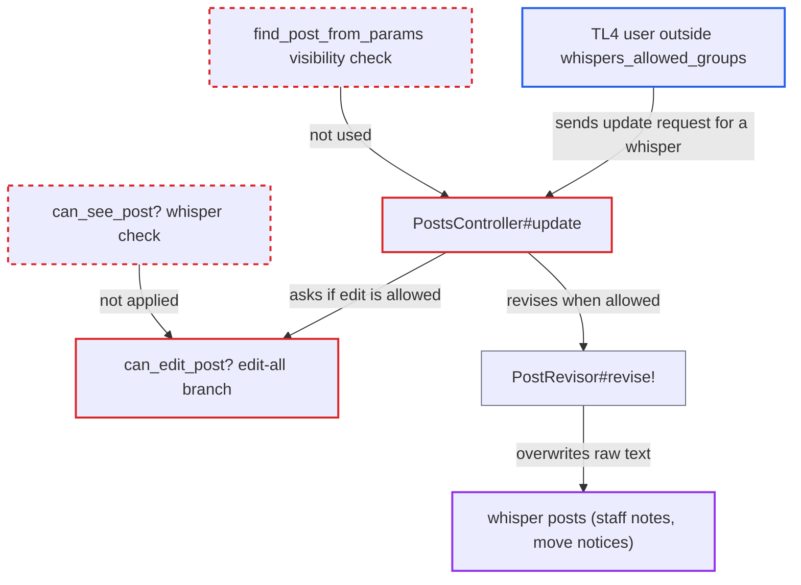

# TL4 edit-all-posts users can overwrite whisper posts they cannot see

| Field | Value |
|---|---|
| ID | `find_01GjnDZyrReyz8z4WB4JtvfY` |
| Severity | **Low** |
| Status | open |
| CWE | CWE-863 — Improper Authorization |
| Created | 2026-10-27T21:16:48.955924Z |
| Claude Security | https://claude.ai/security/findings/find_01GjnDZyrReyz8z4WB4JtvfY |

## Description

A logged-in trust level 4 (TL4) user who is not allowed to see whisper posts can overwrite them, for example admin-only notices and staff notes. They can also learn that hidden whispers exist. The edit permission check `can_edit_post?` checks only topic visibility, not post visibility. `PostsController#update` adds no visibility check of its own.

1. **TL4 attacker** finds a hidden whisper in a public topic. The attacker looks for gaps in post numbers, or sends `PUT /posts/:id` with a mismatching `original_text`. An editable post returns 409 while `GET /posts/:id` returns 404. ([`app/controllers/posts_controller.rb:198-230`](https://github.com/cx-benchmark/discourse/blob/e08ed05b4b1ef773b2de7948a8f88a7c182a3520/app/controllers/posts_controller.rb#L198-L230))
2. **the handler `PostsController#update`** loads the post without a visibility check. It uses a bare `Post.where(id: params[:id])` instead of `find_post_from_params`, so `ensure_can_edit!` is the only gate. ([`app/controllers/posts_controller.rb:198-230`](https://github.com/cx-benchmark/discourse/blob/e08ed05b4b1ef773b2de7948a8f88a7c182a3520/app/controllers/posts_controller.rb#L198-L230))
3. **the method `can_edit_post?`** allows the edit through the edit-all-groups branch. The TL4 group is in `edit_all_post_groups` by default (`1|2|14`). The branch checks only `can_see_post_topic?(post)` and `can_create_post?(post.topic)`, and never calls `can_see_post?`, which is what hides whispers. ([`lib/guardian/post_guardian.rb:164-171`](https://github.com/cx-benchmark/discourse/blob/e08ed05b4b1ef773b2de7948a8f88a7c182a3520/lib/guardian/post_guardian.rb#L164-L171))
4. **the method `PostRevisor#revise!`** rewrites the raw text of the whisper. It does no visibility check of its own. The post stays a whisper, and the controller returns the re-serialized post. ([`lib/post_revisor.rb:289-304`](https://github.com/cx-benchmark/discourse/blob/e08ed05b4b1ef773b2de7948a8f88a7c182a3520/lib/post_revisor.rb#L289-L304))

## Assessment

The attacker is an authenticated non-staff TL4 user who is not in `whispers_allowed_groups`. TL4 is in `edit_all_post_groups` by default, so no setting change is needed. A whisper must exist in a topic the attacker can see. This happens when staff whispers are enabled, or when staff move posts to a message, because `PostMover` then writes a whisper notice into the public topic. Members of a category group moderator role are exposed the same way, because that branch in `can_edit_post?` has the same gap. The attacker can find whispers through gaps in post numbers or through the 409 versus 404 difference on `PUT /posts/:id`.

Impact: The attacker can replace the content of whispers they cannot see, so staff read attacker-chosen text in a staff-only context. The old raw text stays in revision history and staff can revert it. The update response leaks only metadata (author, timestamps, reply target, post type), and the hidden text is not returned. The 409 versus 404 difference lets the attacker confirm that a whisper exists.

## Recommendation

(1) The edit-all-groups and category-group-moderator branches of `can_edit_post?` check topic visibility instead of post visibility. The whisper restriction (`visible_post_types`) that `can_see_post?` enforces is therefore never applied to editing.

Fix criteria: A non-staff user who cannot see a post under `can_see_post?` cannot edit it. This holds even if they are in `edit_all_post_groups` or are a category group moderator. A TL4 user outside `whispers_allowed_groups` who sends `PUT /posts/:id` for a whisper in a public topic gets 403 or 404. They get no 409 for a mismatching `original_text`, and the post is unchanged.

(2) `PostsController#update` skips the shared `find_post_from_params` visibility check that the other post actions use. It loads the post with a bare `Post.where`.

Fix criteria: `update` requires the caller to be able to see the post before any permission or conflict check, and staff can still edit deleted posts. A post the caller cannot see returns 404, with no post data and no revision created.

## Evidence

**https://github.com/cx-benchmark/discourse**

- [`lib/guardian/post_guardian.rb:164-171`](https://github.com/cx-benchmark/discourse/blob/e08ed05b4b1ef773b2de7948a8f88a7c182a3520/lib/guardian/post_guardian.rb#L164-L171)
- [`app/controllers/posts_controller.rb:198-230`](https://github.com/cx-benchmark/discourse/blob/e08ed05b4b1ef773b2de7948a8f88a7c182a3520/app/controllers/posts_controller.rb#L198-L230)
- [`lib/guardian/post_guardian.rb:314-325`](https://github.com/cx-benchmark/discourse/blob/e08ed05b4b1ef773b2de7948a8f88a7c182a3520/lib/guardian/post_guardian.rb#L314-L325)
- [`lib/guardian/post_guardian.rb:190`](https://github.com/cx-benchmark/discourse/blob/e08ed05b4b1ef773b2de7948a8f88a7c182a3520/lib/guardian/post_guardian.rb#L190)
- [`config/site_settings.yml:3097-3101`](https://github.com/cx-benchmark/discourse/blob/e08ed05b4b1ef773b2de7948a8f88a7c182a3520/config/site_settings.yml#L3097-L3101)
- [`config/site_settings.yml:460-470`](https://github.com/cx-benchmark/discourse/blob/e08ed05b4b1ef773b2de7948a8f88a7c182a3520/config/site_settings.yml#L460-L470)
- [`app/models/post_mover.rb:692`](https://github.com/cx-benchmark/discourse/blob/e08ed05b4b1ef773b2de7948a8f88a7c182a3520/app/models/post_mover.rb#L692)
- [`lib/post_revisor.rb:289-304`](https://github.com/cx-benchmark/discourse/blob/e08ed05b4b1ef773b2de7948a8f88a7c182a3520/lib/post_revisor.rb#L289-L304)
- [`spec/requests/posts_controller_spec.rb:242-281`](https://github.com/cx-benchmark/discourse/blob/e08ed05b4b1ef773b2de7948a8f88a7c182a3520/spec/requests/posts_controller_spec.rb#L242-L281)

