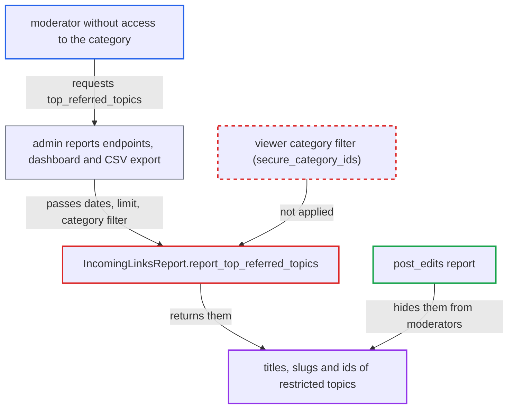

# Top referred topics report discloses restricted-category topic titles to moderators

| Field | Value |
|---|---|
| ID | `find_01GvKpLVgripuPEaGijbYavS` |
| Severity | **Low** |
| Status | open |
| CWE | CWE-862 — Missing authorization |
| Created | 2026-10-27T21:19:26.821904Z |
| Claude Security | https://claude.ai/security/findings/find_01GvKpLVgripuPEaGijbYavS |

## Description

A moderator can read the titles, slugs and ids of topics in read-restricted categories they are not allowed to open. It needs a moderator account, a restricted category, and share-link or external-referrer visits to that category's topics. `Reports::TopReferredTopics` drops the viewer's permissions, and `IncomingLinksReport.report_top_referred_topics` lists topics without any category check.

1. **moderator** requests the `top_referred_topics` report. The request can go to `GET /admin/reports/top_referred_topics.json` or `GET /admin/reports/bulk`. The dashboard and the report CSV export also reach it. The request can set `filters[category]` to a private category id. ([`app/controllers/admin/reports_controller.rb:48-70`](https://github.com/cx-benchmark/discourse/blob/e08ed05b4b1ef773b2de7948a8f88a7c182a3520/app/controllers/admin/reports_controller.rb#L48-L70))
2. **`Report.hidden?`** lets the request through. `top_referred_topics` is not in `ADMIN_ONLY_REPORTS`, so the report is not hidden from moderators. `topic_view_stats` is in that list. ([`app/models/report.rb:41-56`](https://github.com/cx-benchmark/discourse/blob/e08ed05b4b1ef773b2de7948a8f88a7c182a3520/app/models/report.rb#L41-L56))
3. **`Reports::TopReferredTopics`** calls `IncomingLinksReport.find` without the viewer. It passes only the dates, the limit and the category filter, and drops `report.guardian`, so nothing downstream can filter by the viewer's permissions. ([`app/models/concerns/reports/top_referred_topics.rb:7-38`](https://github.com/cx-benchmark/discourse/blob/e08ed05b4b1ef773b2de7948a8f88a7c182a3520/app/models/concerns/reports/top_referred_topics.rb#L7-L38))
4. **`IncomingLinksReport.report_top_referred_topics`** loads the top topics by incoming links. It reads `public_incoming_links`, which excludes only non-regular archetypes, so topics in read-restricted categories are included. It then loads `Topic.select("id, slug, title")` for the top rows. ([`app/models/incoming_links_report.rb:195-231`](https://github.com/cx-benchmark/discourse/blob/e08ed05b4b1ef773b2de7948a8f88a7c182a3520/app/models/incoming_links_report.rb#L195-L231))
5. **`IncomingLinksReport.report_top_referred_topics`** returns `topic_id`, `topic_title` and `topic_url` to the moderator. Nothing applies `secure_category_ids`, which gives a moderator only the categories of the groups they belong to, so restricted topics appear in the result. ([`app/models/user.rb:1622-1631`](https://github.com/cx-benchmark/discourse/blob/e08ed05b4b1ef773b2de7948a8f88a7c182a3520/app/models/user.rb#L1622-L1631))

## Assessment

The attacker is a moderator who is not in the group of a read-restricted category. No victim action is needed. A restricted category must exist, and its topics must have had share-link (`?u=`) or external-referrer visits in the chosen date window. The moderator can use `GET /admin/reports/top_referred_topics.json`, `GET /admin/reports/bulk`, the staff dashboard or the report CSV export. Moderators can reach all of these through the staff-only admin routes.

Impact: A moderator sees titles, slugs and ids of topics in categories they cannot open. Post bodies are not exposed. Only topics with incoming-link activity appear, and each request returns at most 50 rows. Changing the date window and the category id widens coverage.

## Recommendation

`IncomingLinksReport.report_top_referred_topics` lists topics without the viewer's category permissions. `Reports::TopReferredTopics` does not pass the guardian on, and the report is not admin-only. Moderators therefore see topics from read-restricted categories they cannot access.

Fix criteria: For non-admin viewers the report returns only topics in categories the viewer can see (public categories plus `Guardian#secure_category_ids`), or the report is admin-only. A moderator without access to a restricted category gets no row for a topic there that has incoming links. This holds for `/admin/reports/top_referred_topics.json`, `reports/bulk` and the CSV export, with or without `filters[category]` set to that category. An admin and a moderator in the category's group still see the topic.

## Evidence

**https://github.com/cx-benchmark/discourse**

- [`app/models/incoming_links_report.rb:195-231`](https://github.com/cx-benchmark/discourse/blob/e08ed05b4b1ef773b2de7948a8f88a7c182a3520/app/models/incoming_links_report.rb#L195-L231)
- [`app/models/incoming_links_report.rb:245-257`](https://github.com/cx-benchmark/discourse/blob/e08ed05b4b1ef773b2de7948a8f88a7c182a3520/app/models/incoming_links_report.rb#L245-L257)
- [`app/models/concerns/reports/top_referred_topics.rb:7-38`](https://github.com/cx-benchmark/discourse/blob/e08ed05b4b1ef773b2de7948a8f88a7c182a3520/app/models/concerns/reports/top_referred_topics.rb#L7-L38)
- [`app/models/report.rb:41-56`](https://github.com/cx-benchmark/discourse/blob/e08ed05b4b1ef773b2de7948a8f88a7c182a3520/app/models/report.rb#L41-L56)
- [`app/controllers/admin/reports_controller.rb:48-70`](https://github.com/cx-benchmark/discourse/blob/e08ed05b4b1ef773b2de7948a8f88a7c182a3520/app/controllers/admin/reports_controller.rb#L48-L70)
- [`app/models/user.rb:1622-1631`](https://github.com/cx-benchmark/discourse/blob/e08ed05b4b1ef773b2de7948a8f88a7c182a3520/app/models/user.rb#L1622-L1631)
- [`app/models/concerns/reports/post_edits.rb:94-98`](https://github.com/cx-benchmark/discourse/blob/e08ed05b4b1ef773b2de7948a8f88a7c182a3520/app/models/concerns/reports/post_edits.rb#L94-L98)

