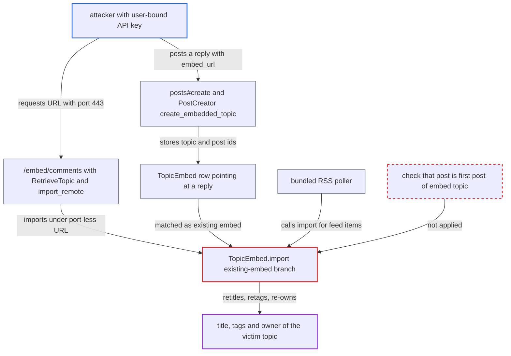

# TopicEmbed.import retitles and re-owns the topic of any post a TopicEmbed row points at

| Field | Value |
|---|---|
| ID | `find_01VKgsPc1dSU5KDUku3FS2Bo` |
| Severity | **Low** |
| Status | open |
| CWE | CWE-862 — Missing Authorization |
| Created | 2026-10-27T22:16:51.426718Z |
| Claude Security | https://claude.ai/security/findings/find_01VKgsPc1dSU5KDUku3FS2Bo |

## Description

A user holding an API key can change the title and tags of other people's topics, and can have their own reply re-attributed to the import user. The title and tags come from a page on an allowed embeddable host. The attack needs an admin-issued API key bound to a non-staff user and a site with an `EmbeddableHost`. The cause is `TopicEmbed.import`, which trusts any matching `TopicEmbed` row and never checks that its post is the first post of the embedded topic.

1. **attacker with a user-bound API key** creates a reply in a victim topic with an `embed_url`. `posts#create` permits `embed_url` for any API key, and `PostCreator#create_embedded_topic` stores the reply's `topic_id` and `post_id` in a `TopicEmbed` row even when the post is a reply. ([`lib/post_creator.rb:427-440`](https://github.com/cx-benchmark/discourse/blob/e08ed05b4b1ef773b2de7948a8f88a7c182a3520/lib/post_creator.rb#L427-L440))
2. **attacker (anonymous)** requests `/embed/comments` with the same page URL written with an explicit `:443` port. No login is needed, and `Jobs::RetrieveTopic` is enqueued whenever `topic_id_for_embed` finds no mapping for the requested string. ([`app/controllers/embed_controller.rb:80-133`](https://github.com/cx-benchmark/discourse/blob/e08ed05b4b1ef773b2de7948a8f88a7c182a3520/app/controllers/embed_controller.rb#L80-L133))
3. **`TopicRetriever`** passes the `:443` URL on because it does not match the stored row. Its only guard checks `TopicEmbed.topic_id_for_embed` on the requested string, and `normalize_url` keeps the explicit port. ([`lib/topic_retriever.rb:33-42`](https://github.com/cx-benchmark/discourse/blob/e08ed05b4b1ef773b2de7948a8f88a7c182a3520/lib/topic_retriever.rb#L33-L42))
4. **`import_remote`** imports under the `FinalDestination` URI, which has no default port. The port is dropped, and same-host redirects and canonical links are followed, so the call becomes `TopicEmbed.import` with `https://host/p`, which matches the stored row. ([`app/models/topic_embed.rb:324-342`](https://github.com/cx-benchmark/discourse/blob/e08ed05b4b1ef773b2de7948a8f88a7c182a3520/app/models/topic_embed.rb#L324-L342))
5. **`TopicEmbed.import`** re-owns the reply and revises it with the remote page's `raw`, `title` and `tags`. It runs `PostOwnerChanger` as `Discourse.system_user`, then `post.revise` with `skip_validations: true`, without checking that the post is the first post of the topic. ([`app/models/topic_embed.rb:114-153`](https://github.com/cx-benchmark/discourse/blob/e08ed05b4b1ef773b2de7948a8f88a7c182a3520/app/models/topic_embed.rb#L114-L153))
6. **`PostRevisor`** applies the title and tags to the victim's topic. The title and tags callbacks run for any `post_number`, with no guardian check and no first-post check. The topic is saved without validation. ([`lib/post_revisor.rb:701-711`](https://github.com/cx-benchmark/discourse/blob/e08ed05b4b1ef773b2de7948a8f88a7c182a3520/lib/post_revisor.rb#L701-L711))

## Assessment

The attacker needs an admin-issued API key bound to a single non-staff user, on a site that has an `EmbeddableHost`. They also need a victim topic they can reply to and an unmapped page on the embeddable host. First they create the reply with `embed_url`. Then the anonymous request to `/embed/comments` triggers the import, and no victim action is needed. The report notes one import per 60 s site-wide. Another way in is the bundled RSS poller. It calls `TopicEmbed.import` directly for every feed item, so a row created in advance for a future item's URL sends it into the same branch against the foreign topic.

Impact: The attacker can retitle a topic they can reply to, a change that normally needs permission to edit the topic, with validations skipped. The title is the `<title>` of the mapped page on the embeddable host. The topic's tags are replaced by the `EmbeddableHost`'s tags when any are configured. The attacker's reply is re-attributed to the import user and given the page body. The content comes from the allowlisted host and is cooked normally, so the report rates this as limited integrity loss, with no XSS and no disclosure.

## Recommendation

(1) The existing-embed branch of `TopicEmbed.import` treats `embed.post` as the embedded topic's first post. It re-owns and revises that post with `title:` and `tags:` without checking that it is the first post of the topic the row names.

Fix criteria: The import changes owner, raw, title or tags only when `embed.post` is the first post of `embed.topic` and `post.topic_id == embed.topic_id`. Otherwise it leaves the post and topic untouched. Test: take a `TopicEmbed` whose post is a reply in another user's topic and re-import it through `/embed/comments` with a `:443` variant, or through the RSS poller. The reply's owner and raw, and the topic's title and tags, must stay unchanged.

(2) `PostRevisor` applies topic-level fields (`title`, `tags`) when it revises a post that is not the first post, with no authorization check. Any internal caller that passes them for a reply silently edits the topic.

Fix criteria: Topic-level fields in a revision are rejected or ignored unless the revised post is the topic's first post. Test: `PostRevisor#revise!` on a post with `post_number > 1` and `title:` does not change `topic.title`.

## Evidence

**https://github.com/cx-benchmark/discourse**

- [`app/models/topic_embed.rb:114-153`](https://github.com/cx-benchmark/discourse/blob/e08ed05b4b1ef773b2de7948a8f88a7c182a3520/app/models/topic_embed.rb#L114-L153)
- [`lib/post_revisor.rb:125-132`](https://github.com/cx-benchmark/discourse/blob/e08ed05b4b1ef773b2de7948a8f88a7c182a3520/lib/post_revisor.rb#L125-L132)
- [`lib/post_revisor.rb:701-711`](https://github.com/cx-benchmark/discourse/blob/e08ed05b4b1ef773b2de7948a8f88a7c182a3520/lib/post_revisor.rb#L701-L711)
- [`app/controllers/posts_controller.rb:234-238`](https://github.com/cx-benchmark/discourse/blob/e08ed05b4b1ef773b2de7948a8f88a7c182a3520/app/controllers/posts_controller.rb#L234-L238)
- [`lib/post_creator.rb:427-440`](https://github.com/cx-benchmark/discourse/blob/e08ed05b4b1ef773b2de7948a8f88a7c182a3520/lib/post_creator.rb#L427-L440)
- [`app/controllers/embed_controller.rb:80-133`](https://github.com/cx-benchmark/discourse/blob/e08ed05b4b1ef773b2de7948a8f88a7c182a3520/app/controllers/embed_controller.rb#L80-L133)
- [`lib/topic_retriever.rb:33-42`](https://github.com/cx-benchmark/discourse/blob/e08ed05b4b1ef773b2de7948a8f88a7c182a3520/lib/topic_retriever.rb#L33-L42)
- [`app/models/topic_embed.rb:324-342`](https://github.com/cx-benchmark/discourse/blob/e08ed05b4b1ef773b2de7948a8f88a7c182a3520/app/models/topic_embed.rb#L324-L342)
- [`lib/url_helper.rb:182-190`](https://github.com/cx-benchmark/discourse/blob/e08ed05b4b1ef773b2de7948a8f88a7c182a3520/lib/url_helper.rb#L182-L190)
- [`plugins/discourse-rss-polling/app/jobs/jobs/discourse_rss_polling/poll_feed.rb:108-118`](https://github.com/cx-benchmark/discourse/blob/e08ed05b4b1ef773b2de7948a8f88a7c182a3520/plugins/discourse-rss-polling/app/jobs/jobs/discourse_rss_polling/poll_feed.rb#L108-L118)

