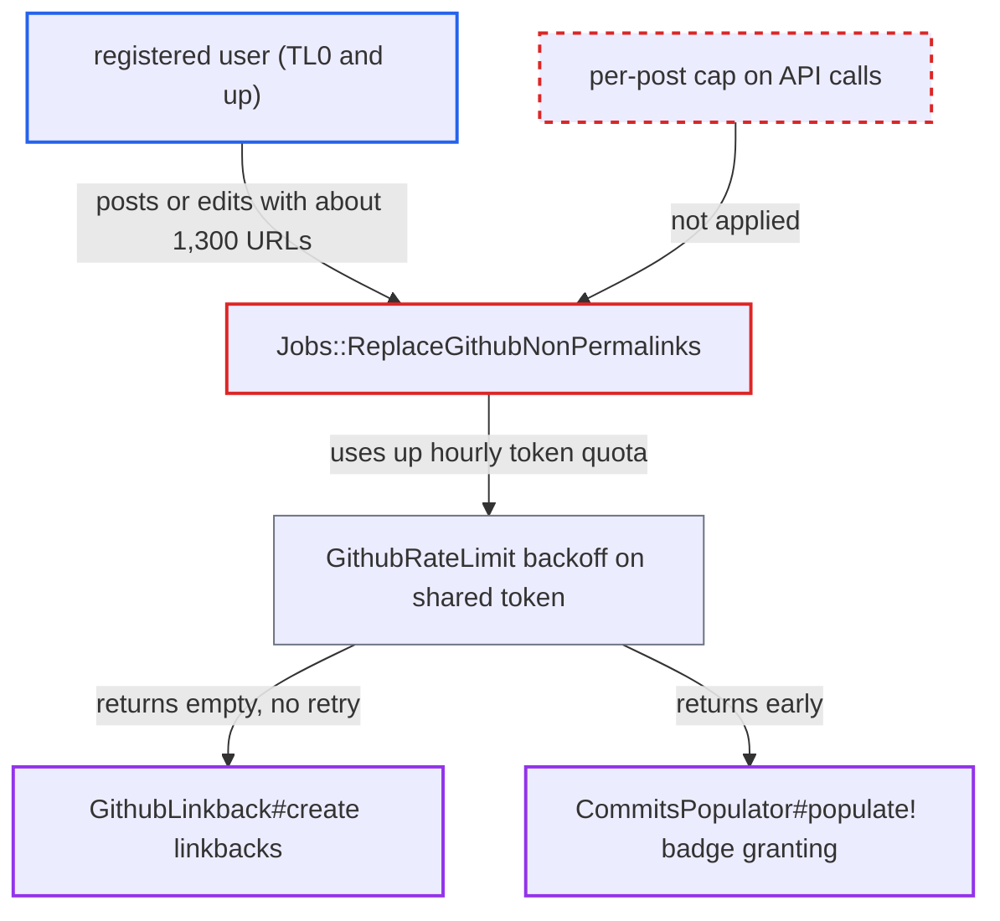

# Unbounded GitHub API calls per post in permalink job exhaust shared linkback token quota

| Field | Value |
|---|---|
| ID | `find_01VhH2bNZCXkUde3Y78EHUQM` |
| Severity | **Low** |
| Status | open |
| CWE | CWE-770 — Resource exhaustion |
| Created | 2026-10-27T21:59:50.578214Z |
| Claude Security | https://claude.ai/security/findings/find_01VhH2bNZCXkUde3Y78EHUQM |

## Description

Any registered user who can create or edit posts can switch off the GitHub plugin's linkback comments and badge granting for all users for up to an hour at a time. They do this by posting thousands of GitHub blob URLs that use up the site's shared GitHub token quota. It needs `enable_discourse_github_plugin`, `github_permalinks_enabled` and a `github_linkback_access_token`. `Jobs::ReplaceGithubNonPermalinks` makes one API call per URL match in the post, with no limit.

1. **attacker** creates or edits a post whose raw text repeats `github.com/a/b/blob/c/d` about 1,300 times. At roughly 24 characters per match, the default `max_post_length` of 32000 allows about 1,300 matches, and matches inside code blocks count too. ([`plugins/discourse-github/plugin.rb:55-59`](https://github.com/cx-benchmark/discourse/blob/e08ed05b4b1ef773b2de7948a8f88a7c182a3520/plugins/discourse-github/plugin.rb#L55-L59))
2. **`GithubPermalinks`** schedules `Jobs::ReplaceGithubNonPermalinks` for the post. Any post under 60 minutes old qualifies, with no trust-level or category gate, and each new edit cancels the pending job and schedules it again. ([`plugins/discourse-github/app/lib/github_permalinks.rb:4-24`](https://github.com/cx-benchmark/discourse/blob/e08ed05b4b1ef773b2de7948a8f88a7c182a3520/plugins/discourse-github/app/lib/github_permalinks.rb#L4-L24))
3. **the job `Jobs::ReplaceGithubNonPermalinks`** sends one authenticated GitHub request for every match found in `post.raw`. Matches are not deduplicated, not capped and not checked against an allow-list, and every request uses the site-wide `github_linkback_access_token`. ([`plugins/discourse-github/app/jobs/regular/replace_github_non_permalinks.rb:17-47`](https://github.com/cx-benchmark/discourse/blob/e08ed05b4b1ef773b2de7948a8f88a7c182a3520/plugins/discourse-github/app/jobs/regular/replace_github_non_permalinks.rb#L17-L47))
4. **the GitHub client in `lib/discourse/github_api.rb`** sends each request and passes the response headers to `GithubRateLimit.note_response_headers`. Only 2xx responses are cached by ETag, so repeating a URL that returns 404 makes every request count against the quota. ([`lib/discourse/github_api.rb:67-108`](https://github.com/cx-benchmark/discourse/blob/e08ed05b4b1ef773b2de7948a8f88a7c182a3520/lib/discourse/github_api.rb#L67-L108))
5. **`GithubRateLimit`** records a backoff for the token once GitHub reports no requests remaining. The backoff lasts up to `MAX_SECONDS` (1 hour) and is keyed only by the token, so every consumer of that token is blocked. ([`lib/github_rate_limit.rb:18-46`](https://github.com/cx-benchmark/discourse/blob/e08ed05b4b1ef773b2de7948a8f88a7c182a3520/lib/github_rate_limit.rb#L18-L46))
6. **`GithubLinkback#create`** returns `[]` while the client is backing off. Linkback comments for other users' posts are skipped and not retried. ([`plugins/discourse-github/app/lib/github_linkback.rb:94-102`](https://github.com/cx-benchmark/discourse/blob/e08ed05b4b1ef773b2de7948a8f88a7c182a3520/plugins/discourse-github/app/lib/github_linkback.rb#L94-L102))
7. **`CommitsPopulator#populate!`** returns early while the token is backing off. Contributor and committer badges are not granted during that time. ([`plugins/discourse-github/app/lib/commits_populator.rb:97-104`](https://github.com/cx-benchmark/discourse/blob/e08ed05b4b1ef773b2de7948a8f88a7c182a3520/plugins/discourse-github/app/lib/commits_populator.rb#L97-L104))

## Assessment

The attacker is any registered user who can create or edit posts (TL0 and up). The site needs the GitHub plugin, `github_permalinks_enabled` and a linkback token. The attacker posts, or edits within the post's first hour, a post that repeats `github.com/a/b/blob/c/d` about 1,300 times, optionally inside a code fence. After `editing_grace_period` the job makes one request per match. Each edit within the first hour reruns the full set. A few such posts or edits per hour pass GitHub's 5,000 requests/hour quota. No victim action is needed, and the attacker can repeat this each time the quota window resets. Distinct refs are not needed.

Impact: For every user, the plugin's GitHub linkback and badge-granting features stop for each induced backoff, up to one hour and repeatable. Linkbacks skipped in that window are never retried. A Sidekiq low-queue worker is also held while it makes the requests. No data is disclosed or changed, and the core forum keeps working.

## Recommendation

`Jobs::ReplaceGithubNonPermalinks` makes one privileged GitHub API call for every regex match in attacker-written post text, with no bound. One post can use up the shared token's quota and disable the other features that use that token.

Fix criteria: A configurable limit bounds the GitHub API calls made for one post, for example by reusing `github_linkback_maximum_links` and skipping the post or the excess matches. Matches are also deduplicated. To verify, process a post with hundreds of GitHub blob URLs, repeated or distinct, and edit it repeatedly within its first hour. It makes no more than the configured number of requests per run and does not put the token into backoff.

## Evidence

**https://github.com/cx-benchmark/discourse**

- [`plugins/discourse-github/app/jobs/regular/replace_github_non_permalinks.rb:17-47`](https://github.com/cx-benchmark/discourse/blob/e08ed05b4b1ef773b2de7948a8f88a7c182a3520/plugins/discourse-github/app/jobs/regular/replace_github_non_permalinks.rb#L17-L47)
- [`plugins/discourse-github/app/lib/github_permalinks.rb:4-24`](https://github.com/cx-benchmark/discourse/blob/e08ed05b4b1ef773b2de7948a8f88a7c182a3520/plugins/discourse-github/app/lib/github_permalinks.rb#L4-L24)
- [`plugins/discourse-github/plugin.rb:55-59`](https://github.com/cx-benchmark/discourse/blob/e08ed05b4b1ef773b2de7948a8f88a7c182a3520/plugins/discourse-github/plugin.rb#L55-L59)
- [`plugins/discourse-github/app/lib/github_linkback.rb:94-102`](https://github.com/cx-benchmark/discourse/blob/e08ed05b4b1ef773b2de7948a8f88a7c182a3520/plugins/discourse-github/app/lib/github_linkback.rb#L94-L102)
- [`lib/discourse/github_api.rb:67-108`](https://github.com/cx-benchmark/discourse/blob/e08ed05b4b1ef773b2de7948a8f88a7c182a3520/lib/discourse/github_api.rb#L67-L108)
- [`lib/github_rate_limit.rb:18-46`](https://github.com/cx-benchmark/discourse/blob/e08ed05b4b1ef773b2de7948a8f88a7c182a3520/lib/github_rate_limit.rb#L18-L46)
- [`plugins/discourse-github/app/lib/commits_populator.rb:97-104`](https://github.com/cx-benchmark/discourse/blob/e08ed05b4b1ef773b2de7948a8f88a7c182a3520/plugins/discourse-github/app/lib/commits_populator.rb#L97-L104)

