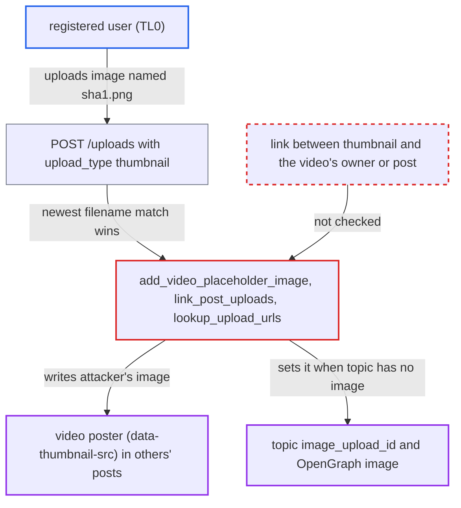

# Video poster thumbnail resolved by user-chosen filename lets anyone replace others' video thumbnails

| Field | Value |
|---|---|
| ID | `find_01LPX8Wvs2eWxYKTHnzH4WYR` |
| Severity | **Low** |
| Status | open |
| CWE | CWE-285 — Improper authorization |
| Created | 2026-10-27T21:23:31.145384Z |
| Claude Security | https://claude.ai/security/findings/find_01LPX8Wvs2eWxYKTHnzH4WYR |

## Description

Any registered user, even a brand-new trust level 0 account, can replace the poster image of other people's videos. They can also replace the topic thumbnail and OpenGraph image where the topic has no image yet. The attacker uploads an image named after the video's sha1. The server links a video to its thumbnail only by that filename, picks the newest match, and never checks who uploaded it.

1. **attacker (registered user)** reads the video sha1 from a post. The sha1 is public in the post's `data-video-src` attribute, which looks like `…/original/1X/<sha1>.mp4`.
2. **attacker** uploads an image named `<sha1>.png` through `POST /uploads`. `UploadCreator` keeps the uploader's `original_filename`, and with `upload_type=thumbnail` it skips duplicate detection, so a new upload is always created. ([`lib/upload_creator.rb:196-207`](https://github.com/cx-benchmark/discourse/blob/e08ed05b4b1ef773b2de7948a8f88a7c182a3520/lib/upload_creator.rb#L196-L207))
3. **server cook** runs `add_video_placeholder_image` when the victim's post is cooked again. It picks `Upload.where("original_filename LIKE ?", "<sha1>.%").last`, the newest upload of any user with that prefix, which is the attacker's, and writes its URL into `data-thumbnail-src`. ([`lib/pretty_text.rb:422-439`](https://github.com/cx-benchmark/discourse/blob/e08ed05b4b1ef773b2de7948a8f88a7c182a3520/lib/pretty_text.rb#L422-L439))
4. **post upload linking** runs `link_post_uploads`, which uses the same filename lookup and `order(id: :desc)`. `handle_video_thumbnail` sets `topic.image_upload_id` to the attacker's upload when the first post contains the video and the topic has no image yet. ([`app/models/concerns/has_post_upload_references.rb:12-28`](https://github.com/cx-benchmark/discourse/blob/e08ed05b4b1ef773b2de7948a8f88a7c182a3520/app/models/concerns/has_post_upload_references.rb#L12-L28))
5. **editor lookup** resolves the sha1 through `lookup_upload_urls` (`POST /uploads/lookup-urls`). It also returns the latest upload with that filename prefix, so the editor's video view shows the attacker's image. ([`lib/pretty_text/helpers.rb:44-60`](https://github.com/cx-benchmark/discourse/blob/e08ed05b4b1ef773b2de7948a8f88a7c182a3520/lib/pretty_text/helpers.rb#L44-L60))

## Assessment

The attacker needs only a registered account (trust level 0) that can see a post containing an uploaded video. `video_thumbnails_enabled` is `true` by default. The attack takes effect the next time the victim's post is cooked on the server. That happens on an author edit, a staff action, a quote by any user, a rebake, a new post reusing the upload, or the periodic `rebake_old`. The report names re-cook timing as the main requirement. The victim does nothing beyond normal use of the site.

Impact: The attacker controls the poster image shown for other users' videos, for example an offensive or deceptive "click to play" image. Where the topic has no image yet, they also control its list thumbnail and OpenGraph image. This defaces content only. The report finds no data disclosure, no availability impact and no extra access. The attacker's upload does become referenced by the victim's post.

## Recommendation

Thumbnail resolution trusts the uploader-supplied `original_filename` as the only link between a video and its poster. It has no ownership or post-scoped relation and prefers the newest match.

Fix criteria: A video's thumbnail comes only from an upload the system explicitly associated with that video. That can be a stored relation created at upload time, or a restriction to uploads by the video's uploader or referenced by the same post. Uploads from other users with a matching filename are ignored in `add_video_placeholder_image`, `link_post_uploads` and `lookup_upload_urls`. To verify, upload `<sha1>.png` from a second account and rebake the victim post. `data-thumbnail-src` and `topic.image_upload_id` must be unchanged.

## Evidence

**https://github.com/cx-benchmark/discourse**

- [`lib/pretty_text.rb:422-439`](https://github.com/cx-benchmark/discourse/blob/e08ed05b4b1ef773b2de7948a8f88a7c182a3520/lib/pretty_text.rb#L422-L439)
- [`app/models/concerns/has_post_upload_references.rb:12-28`](https://github.com/cx-benchmark/discourse/blob/e08ed05b4b1ef773b2de7948a8f88a7c182a3520/app/models/concerns/has_post_upload_references.rb#L12-L28)
- [`lib/pretty_text/helpers.rb:44-60`](https://github.com/cx-benchmark/discourse/blob/e08ed05b4b1ef773b2de7948a8f88a7c182a3520/lib/pretty_text/helpers.rb#L44-L60)
- [`lib/upload_creator.rb:196-207`](https://github.com/cx-benchmark/discourse/blob/e08ed05b4b1ef773b2de7948a8f88a7c182a3520/lib/upload_creator.rb#L196-L207)

