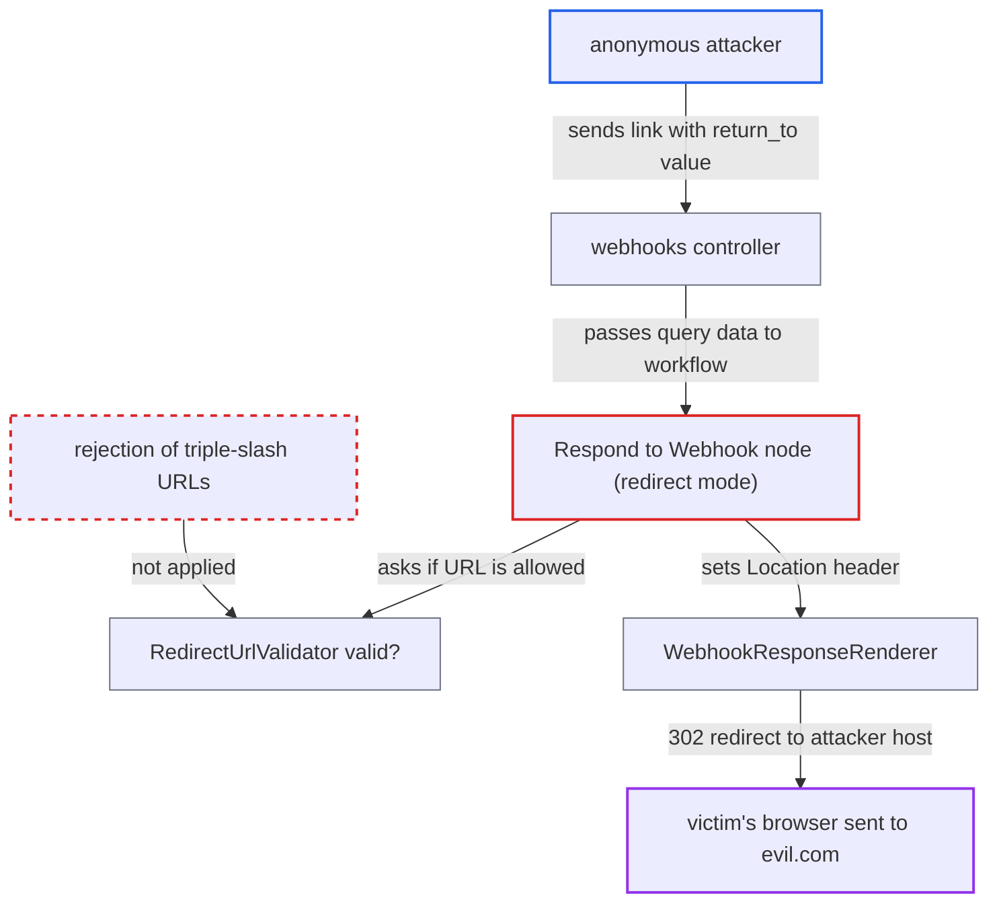

# Webhook redirect allowlist bypass via triple-slash '///host' URL in RedirectUrlValidator

| Field | Value |
|---|---|
| ID | `find_016Pb2fnGFtG68t1Td2v6Nhp` |
| Severity | **Low** |
| Status | open |
| CWE | CWE-601 — Open redirect |
| Created | 2026-10-27T21:10:00.724819Z |
| Claude Security | https://claude.ai/security/findings/find_016Pb2fnGFtG68t1Td2v6Nhp |

## Description

An anonymous internet user can use the forum as an open redirect and send a victim who clicks a forum link to any site, for example for phishing. It works only when an admin has published a webhook workflow whose `Respond to Webhook` redirect URL comes from request data. `RedirectUrlValidator#valid?` wrongly accepts `///evil.com` as a local path.

1. **attacker** sends the victim a forum webhook link with a crafted query value. The link looks like `/workflows/webhooks/<path>?return_to=///evil.com`, and the webhook route needs no login, CSRF token or XHR header. ([`plugins/discourse-workflows/app/controllers/discourse_workflows/webhooks_controller.rb:7-31`](https://github.com/cx-benchmark/discourse/blob/e08ed05b4b1ef773b2de7948a8f88a7c182a3520/plugins/discourse-workflows/app/controllers/discourse_workflows/webhooks_controller.rb#L7-L31))
2. **webhook request** exposes the query string to the workflow as trigger data. A `redirect_url` expression such as `={{ $json.query.return_to }}` therefore resolves to the attacker's text. ([`plugins/discourse-workflows/lib/discourse_workflows/webhook_request.rb:41-52`](https://github.com/cx-benchmark/discourse/blob/e08ed05b4b1ef773b2de7948a8f88a7c182a3520/plugins/discourse-workflows/lib/discourse_workflows/webhook_request.rb#L41-L52))
3. **`RedirectUrlValidator#valid?`** accepts `///evil.com` as a same-site path. `URI.parse` reads it as relative with a nil host and path `/evil.com`, so the first rule returns true before any host or allowlist check. ([`plugins/discourse-workflows/lib/discourse_workflows/redirect_url_validator.rb:14-25`](https://github.com/cx-benchmark/discourse/blob/e08ed05b4b1ef773b2de7948a8f88a7c182a3520/plugins/discourse-workflows/lib/discourse_workflows/redirect_url_validator.rb#L14-L25))
4. **the `Respond to Webhook` node** copies the accepted value unchanged into the `Location` header of a 302 response. In `redirect` mode the validator is the only check on the resolved `redirect_url`. ([`plugins/discourse-workflows/lib/discourse_workflows/nodes/respond_to_webhook/v1.rb:139-155`](https://github.com/cx-benchmark/discourse/blob/e08ed05b4b1ef773b2de7948a8f88a7c182a3520/plugins/discourse-workflows/lib/discourse_workflows/nodes/respond_to_webhook/v1.rb#L139-L155))
5. **`WebhookResponseRenderer`** sends the redirect with `allow_other_host: true`. That turns off the Rails open-redirect guard, and Rails leaves a string starting with `//` unchanged, so the browser gets `Location: ///evil.com`. ([`plugins/discourse-workflows/lib/discourse_workflows/webhook_response_renderer.rb:17-20`](https://github.com/cx-benchmark/discourse/blob/e08ed05b4b1ef773b2de7948a8f88a7c182a3520/plugins/discourse-workflows/lib/discourse_workflows/webhook_response_renderer.rb#L17-L20))
6. **victim's browser** follows the redirect to `https://evil.com/`. The browser's URL parser skips the extra slashes after the scheme, so `///evil.com` resolved against the forum origin points at `evil.com`.

## Assessment

The attacker is an anonymous internet user who needs no account. Two things outside their control must hold. `enable_discourse_workflows` must be on (it defaults to off and is in beta). An admin must also have published a webhook workflow with `response_mode: response_node` whose `Respond to Webhook` redirect URL is bound to request data. The attacker then needs a victim to open the crafted forum link. The bypass works even when no `allowed_redirect_domains` allowlist is configured.

Impact: The attacker can send a victim from the forum's trusted origin to any site they choose, for example for phishing. No forum data is read or changed, and the report sees no effect on confidentiality or availability.

## Recommendation

`RedirectUrlValidator#valid?` treats any URI that Ruby parses as relative with a blank host as a safe local path. Browsers resolve `///host` and `////host` as pointing at another host, so the allowlist can be bypassed.

Fix criteria: A redirect target is accepted as a local path only if it starts with exactly one `/` followed by a character other than `/` or `\`, or is otherwise canonicalised to a single-origin URL before checking. `///evil.com`, `////evil.com`, `/\evil.com` and whitespace-prefixed variants are rejected or rewritten to the forum origin. To verify, configure a redirect response bound to a query parameter and request it with `?return_to=///evil.com`. The result must be the `invalid_redirect_url` 400 or a same-origin `Location`, not a 302 to `///evil.com`.

## Evidence

**https://github.com/cx-benchmark/discourse**

- [`plugins/discourse-workflows/lib/discourse_workflows/redirect_url_validator.rb:14-25`](https://github.com/cx-benchmark/discourse/blob/e08ed05b4b1ef773b2de7948a8f88a7c182a3520/plugins/discourse-workflows/lib/discourse_workflows/redirect_url_validator.rb#L14-L25)
- [`plugins/discourse-workflows/lib/discourse_workflows/nodes/respond_to_webhook/v1.rb:139-155`](https://github.com/cx-benchmark/discourse/blob/e08ed05b4b1ef773b2de7948a8f88a7c182a3520/plugins/discourse-workflows/lib/discourse_workflows/nodes/respond_to_webhook/v1.rb#L139-L155)
- [`plugins/discourse-workflows/lib/discourse_workflows/webhook_response_renderer.rb:17-20`](https://github.com/cx-benchmark/discourse/blob/e08ed05b4b1ef773b2de7948a8f88a7c182a3520/plugins/discourse-workflows/lib/discourse_workflows/webhook_response_renderer.rb#L17-L20)
- [`plugins/discourse-workflows/app/controllers/discourse_workflows/webhooks_controller.rb:7-31`](https://github.com/cx-benchmark/discourse/blob/e08ed05b4b1ef773b2de7948a8f88a7c182a3520/plugins/discourse-workflows/app/controllers/discourse_workflows/webhooks_controller.rb#L7-L31)
- [`plugins/discourse-workflows/lib/discourse_workflows/webhook_request.rb:41-52`](https://github.com/cx-benchmark/discourse/blob/e08ed05b4b1ef773b2de7948a8f88a7c182a3520/plugins/discourse-workflows/lib/discourse_workflows/webhook_request.rb#L41-L52)
- [`plugins/discourse-workflows/config/locales/client.en.yml:1427`](https://github.com/cx-benchmark/discourse/blob/e08ed05b4b1ef773b2de7948a8f88a7c182a3520/plugins/discourse-workflows/config/locales/client.en.yml#L1427)

